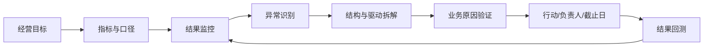

# 经营分析

> 返回 [[知识库首页]] ｜ 平行专题：[[4-数据分析/分析方法/商业分析方法|商业分析]]

> 经营分析关注“业务现在运行得怎么样、为什么变化、下一步做什么”：把收入、成本、利润、库存、现金和业务动作连接起来，形成持续复盘和行动闭环。

## 一、核心问题

1. 经营发生了什么？
2. 为什么会发生？
3. 变化发生在哪个产品、渠道、站点、客户或流程？
4. 影响是价格、销量、结构、成本、费用、效率还是现金？
5. 下一步由谁在什么时候采取什么行动？
6. 如何验证行动是否有效？

## 二、经营分析闭环

## 三、核心分析框架

### 1. 利润结果层

- GMV、净销售、毛利、贡献利润、经营利润
- 平台费、广告、促销、履约、退款、仓储和 Coop
- 利润瀑布和期间对比

### 2. 结构层

- 平台、站点、国家、渠道、店铺
- SKU、ASIN、产品、品类和客户
- 高毛利/低毛利、增长/利润、库存/现金结构

### 3. 驱动层

- 销量、价格、折扣、产品结构、渠道结构
- COGS、汇率、平台费、广告、履约、退款和仓储
- 库存周转、结算周期、应收、现金和资金占用

### 4. 行动层

- 问题、证据、原因、建议、负责人、截止日
- 预期收益、风险、依赖条件和回测指标
- 区分战略性低毛利与经营性失控

## 四、已有核心资产

### 经营分析框架

- [[8-知识库管理/Clippings处理/11-财务分析三套底层模型]]：利润、结构、驱动三套模型
- [[8-知识库管理/Clippings处理/13-毛利率三层九格拆解]]：价格、成本、结构拆解
- [[8-知识库管理/Clippings处理/14-三张财务报表分析顺序]]：利润、资产负债和现金联动
- [[8-知识库管理/Clippings处理/15-经营分析四个问题]]：发生什么、为什么、下一步做什么
- [[8-知识库管理/Clippings处理/12-多产品盈亏平衡分析]]：当前正文不完整，待补证据

### 跨境电商经营底座

- [[5-正式知识资产/数据分析/P&L利润链路总览]]
- [[5-正式知识资产/数据/跨境电商数据治理SOP]]
- [[8-知识库管理/首批知识卡片/03-Amazon-VC-P&L利润链路]]
- [[8-知识库管理/首批知识卡片/04-跨境电商成本COGS归集方法]]
- [[8-知识库管理/首批知识卡片/05-Amazon-VC-Coop与PO-DF-DI扣点]]
- [[5-正式知识资产/面试/PowerBI平台面试表达版本]]

## 五、月度经营复盘模板

### A. 事实层：发生了什么

- 本期收入、利润、毛利率、费用率和现金变化
- 环比、同比、预算差异
- 受影响最大的站点、SKU、渠道和费用项目

### B. 原因层：为什么发生

- 价格、销量、结构
- 成本、广告、促销、履约、退款、仓储
- 库存、结算、应收、汇率和一次性因素
- 事实、推断和待验证假设分别记录

### C. 行动层：接下来做什么

| 问题 | 行动 | 负责人 | 截止日 | 预期影响 | 回测指标 |
| --- | --- | --- | --- | --- | --- |
|  |  |  |  |  |  |

## 六、最低质量检查

- [ ] 指标口径和日期范围明确。
- [ ] 数据源、粒度和渠道边界明确。
- [ ] 价格、成本、结构归因没有重复计算。
- [ ] 广告、促销和费用先聚合再关联。
- [ ] 金额、销量、库存和利润结果可对账。
- [ ] 结论有证据，推断有假设，建议有负责人。
- [ ] 行动有回测指标，不停留在描述问题。

## 七、最小实践任务

选一个完整月度 Amazon VC P&L，制作一页经营复盘：

1. 一张利润瀑布。
2. 一张站点/SKU/渠道结构贡献图。
3. 一张价格—成本—结构驱动桥。
4. 三条事实—原因—行动记录。

验收标准：每条结论都能追溯到来源和口径，并能说明下一步如何验证。

## 八、下一步

- 将 11、13、14、15 四张卡片整合为正式经营复盘模板。
- 将毛利三层九格加入 P&L 利润链路总览。
- 建立平台/站点/SKU 粒度的经营指标字典。
- 进一步补充现金流、库存和盈亏平衡分析。
