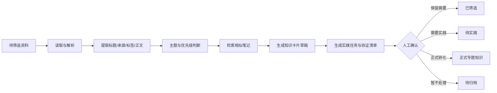

# Obsidian 资料筛选 Agent 设计说明

## 1. 目标

为收藏资料提供一个受控的 AI 处理流程：判断主题和价值、查找关联笔记、生成知识卡片草稿、提出实践任务，但不自动覆盖正式笔记、不自动删除资料、不把外部观点写成个人经验。

## 2. 第一版范围

### 输入

- `8-知识库管理/99-收件箱/待筛选/` 中的 Markdown、TXT、PDF、Word 或网页剪藏。
- 已有 Vault 中可检索的正式知识和知识卡片。
- 用户指定的单篇或批量资料。

### 输出

- 一句话结论
- 核心观点
- 主题和优先级
- 对当前工作和职业目标的价值
- 相似或关联笔记
- 重复 / 互补 / 冲突提示
- 是否需要完整阅读
- 可转化资产
- 最小实践任务
- 需要人工验证的内容
- 知识卡片草稿

### 明确不做

- 不自动覆盖原始资料。
- 不自动移动、删除或合并笔记。
- 不自动把 AI 总结写入正式规则。
- 不执行生产数据库写入或关键业务计算。
- 不把课程示例或外部文章当作已经完成的项目成果。

## 3. 处理流程



## 4. Agent 与确定性程序分工

### 确定性程序负责

- 文件遍历和排除规则
- 编码读取和文件大小限制
- Markdown frontmatter、标题、标签提取
- 文件路径和来源记录
- 处理状态写入
- 报告格式和审计日志
- 输出目录边界检查

当前可复用脚本：`8-知识库管理/scripts/obsidian_audit.py`。

### AI Agent 负责

- 资料主题判断
- 重要程度和优先级建议
- 内容摘要和观点分层
- 与已有知识的语义关联
- 重复、互补和冲突提示
- 实践任务和验收标准建议
- 用自然语言生成知识卡片草稿

### 人工负责

- 确认个人经验和项目事实
- 确认生产业务规则和财务口径
- 确认是否进入正式目录
- 确认高风险内容的实践结果
- 批准移动、合并或删除等高风险操作

## 5. 知识卡片输出结构

```markdown
---
type: summary
status: summarized
importance: S/A/B/C
source_type: article/tutorial/project/experience/ai_generated
source_path:
related_notes: []
needs_human_review: true
---

# 标题｜知识卡片

## 一句话结论
## 核心观点
## 对我的价值
## 与已有知识的关系
## 需要验证的内容
## 最小实践任务
## 我的最终判断
```

## 6. 优先级规则

- `S`：直接影响当前跨境电商、BI、P&L、AI Agent 或求职目标，优先处理。
- `A`：可转化为项目、方法论、SOP 或近期能力提升。
- `B`：保留摘要，暂不投入完整阅读。
- `C`：仅归档，除非未来检索需要，不主动处理。

建议考虑：相关度、独特性、可实践程度、时效性和阅读成本。

## 7. 检索与关联

优先使用现有 `vault-curate` 能力或同类检索：

1. 先按标题、标签和路径做关键词检索。
2. 再按正文做 BM25 / 语义相似检索。
3. 只把高相关笔记作为候选关联，不直接修改关联笔记。
4. 对候选关联给出“重复、互补、冲突、上下游”判断。
5. 对正式规则和项目结果优先要求人工确认。

## 8. 安全与可信度

每份输出都必须区分：

- 外部资料观点
- 教程示例
- 用户真实经验
- 已验证项目事实
- AI 推断或建议
- 待确认规则

涉及数字、财务、生产、个人经历和项目成果时，默认 `needs_human_review: true`。

## 9. 评估指标

第一版不追求模型复杂度，优先观察：

- 是否减少用户筛选时间
- 高优先级资料是否被正确识别
- 关联笔记是否有用
- 摘要是否忠于来源
- 是否减少重复阅读
- 实践任务是否可执行
- 是否出现事实、规则或个人经历误写

## 10. 最小可行版本

第一阶段只需支持：

1. 扫描待筛选目录。
2. 读取 Markdown 和常见文本。
3. 生成处理队列。
4. 对用户指定资料生成卡片。
5. 人工确认后才进入正式知识目录。

后续再考虑批量 LLM 调用、Obsidian 命令面板、语义检索、重复检测和定期学习建议。

## 11. 当前下一步

- 用 3-5 篇收藏资料进行小规模试运行。
- 记录 AI 摘要与人工判断的差异。
- 优化优先级和主题规则。
- 形成固定的知识卡片格式后，再考虑批量自动化。
