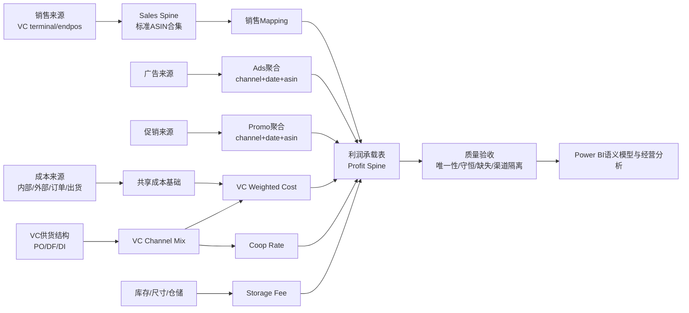

# Amazon VC P&L 利润链路总览

> 本文是由首批知识卡片合并形成的工作版总览，不替代数据库当前状态、正式规则总表或项目原始文档。

## 1. 总体架构

## 2. 口径边界

- `VC terminal/endpos`：当前 SalesAmt 主事实，代表终端消费者零售表现。
- `VC supply/order`：供货或采购视角，用于供货结构、Coop 和成本权重。
- `PO / DF / DI`：Amazon VC 内部供货模式，不是顶层渠道。
- 共享库存、原始 COGS、Kit、NS Mapping 和尺寸不在源表层强贴 `Amz VC`。
- 销售、广告、促销、VC mix、weighted cost、Coop 和利润结果按渠道隔离。

## 3. 计算顺序

1. 建立销售、广告和促销标准 ASIN 合集。
2. 形成销售 spine，并完成销售 Mapping。
3. 建立 SKU / 渠道 Mapping。
4. 根据供货口径计算 VC channel mix。
5. 归集多来源成本并计算 VC weighted cost。
6. 根据供货结构计算 Coop rate。
7. 叠加成本、Coop、促销和广告。
8. 加入库存维度、仓储费和仓储费分摊。
9. 形成最终利润承载表，再供 Power BI 使用。

## 4. 关键防错规则

### 4.1 先聚合再 Join

Ads 和 Promo 先按 `channel + date + asin` 聚合，再 Join 到利润 spine。不能把明细表直接多对多 Join 到主表，否则会放大金额。

### 4.2 成本先共享、后渠道化

成本基础表保留来源和跨渠道属性，进入 VC 利润时再根据 PO/DF/DI 结构计算渠道专属成本。

### 4.3 Kit 按子件计算

Kit 父 SKU 成本应由子 SKU 成本乘以数量形成，不能简单寻找父 SKU 的单一成本。

### 4.4 默认值必须带状态

Coop 缺失时的默认值必须标记为默认规则，不得伪装成真实匹配；业务规则应保留来源、确认人、生效范围和版本。

## 5. 最低验收清单

- [ ] `date + asin` 唯一。
- [ ] SalesAmt 与来源销售事实守恒。
- [ ] Ads / Promo 标准 ASIN 金额与最终表守恒。
- [ ] 有销售额但 Coop rate 不为 0。
- [ ] VC 专属表渠道均为 `Amz VC`。
- [ ] 仓储费分摊结果与库存池守恒。
- [ ] 成本结果具备来源血缘和月份口径。
- [ ] 缺失 Mapping、成本、汇率和日期范围能够被质量规则发现。

## 6. 当前待确认事项

- 最终表名、粒度和刷新过程是否仍为当前生产状态。
- PO/DF/DI 扣点和默认规则是否仍为 active。
- 各过程的实际负责人、运行日志和失败处理方式。
- 可公开用于面试的项目结果数字。
