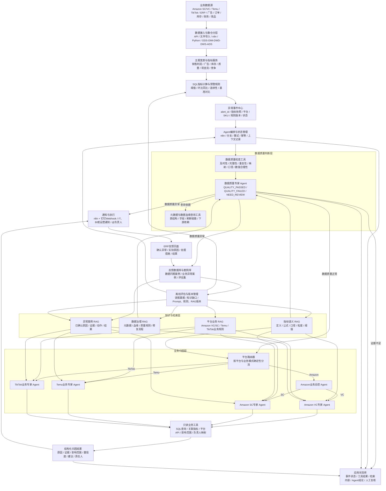

# 业务分析与运营 - BA

> 用于准备“AI 数据产品解决方案顾问 / AI 应用咨询顾问 / 数据智能实施顾问”岗位面试。
>
> 本笔记基于招聘需求、杨天一简历及此前关于 BA、DataAgent、知识库和数据智能项目的讨论整理。后续面试复盘和答案优化继续补充在本文档中。

## 招聘需求速查（面试前先看）

### 岗位名称与定位

岗位可理解为：

> AI 数据产品解决方案顾问 / AI 应用咨询顾问 / 数据智能实施顾问。

核心工作是理解客户业务问题，设计指标、标签、埋点和数据分析方案，结合 AI Agent、知识库、BI 或增长营销产品完成落地，并通过培训、交付和复盘推动客户真正使用。

### 核心职责

- 深入理解客户业务场景、核心诉求和痛点。
- 梳理业务分析框架，输出分析报告和解决方案。
- 设计行业指标体系、标签体系和埋点方案。
- 参与 DataAgent、知识引擎、增长营销等数据产品实施。
- 负责客户培训、方法传递和产品推广使用。
- 处理交付问题，协调项目团队并推动高质量落地。
- 输出需求分析、指标定义、数据方案和项目实施文档。

### 能力要求

#### 业务与数据

- 具备业务分析、数据产品或解决方案经验。
- 熟悉 SQL、数据采集、BI 宽表和数据分析报告。
- 理解指标口径、标签体系、埋点设计和数据治理。
- 了解 BI、CDP、UBA、MA 等数据产品或应用场景。

#### AI 应用

- 了解大模型、AI Agent、DataAgent 和知识引擎。
- 理解知识库管理、知识体系搭建和 RAG 基本逻辑。
- 了解 Coze、Dify、hiAgent 等大模型应用工具。
- 具备 Prompt、Skill 或 Agent 工作流设计经验。
- 能将 AI 应用到数据分析、经营诊断和增长营销场景。

#### 交付与沟通

- 能独立对接客户和多方干系人。
- 能将业务语言翻译成数据和技术方案。
- 具备良好的沟通协调、文档输出和项目推进能力。
- 能开展客户培训、问题处理和落地复盘。

### 面试判断重点

面试官大概率重点判断四件事：

1. 你是否真正理解 AI Agent 的搭建，而不是只会调用模型。
2. 你是否能把客户业务问题拆成指标、数据、规则和应用。
3. 你是否能独立完成方案沟通、产品实施和客户交付。
4. 你是否具备把 AI 产品落到真实业务流程中的能力。

### 你的岗位匹配切入点

你可以把自己的经验定位为：

> 懂业务、懂数据、懂 BI 和数据治理，并且已经将 AI 接入经营分析流程，能够把客户业务问题转化为指标体系、数据方案和 AI 应用落地方案的复合型候选人。

## 零、AI Agent 系统科普

### 1. AI Agent 是什么

AI Agent（人工智能智能体）可以理解为：

> 以大语言模型为核心，能够理解目标、判断当前状态、制定或选择执行步骤、调用外部工具，并根据结果继续完成任务的智能软件系统。

它不是一个单独的模型，也不是简单的聊天机器人，而是一套由“模型 + 指令 + 上下文 + 知识 + 工具 + 流程 + 记忆 + 安全控制”组成的应用系统。

最基本的运行闭环是：

```text
接收目标
→ 理解任务
→ 获取上下文和知识
→ 判断需要哪些步骤
→ 调用工具执行
→ 读取执行结果
→ 检查是否完成
→ 继续执行或输出结果
```

例如，用户问：

> 为什么本月 Amazon 某个 SKU 的利润下降？

普通聊天机器人可能只能根据用户提供的文字进行解释；数据分析 Agent 则可以：

```text
识别问题：利润下降
→ 查询销售、广告、成本、库存和退货数据
→ 对比上月和目标值
→ 检索利润指标定义及归因规则
→ 判断主要影响因素
→ 输出证据、结论和建议
→ 必要时通知负责人或创建任务
```

因此，Agent 的关键不在于“用了 AI”这件事，而在于它是否能够围绕目标完成一段有状态、有工具、有反馈的任务。

### 2. Agent 与相关概念的区别

| 概念 | 核心特点 | 典型例子 |
| --- | --- | --- |
| 大语言模型 LLM | 理解和生成文字，本身不掌握企业实时数据 | GPT、豆包等模型 |
| 聊天机器人 | 对话问答，通常只根据当前输入和上下文回答 | FAQ 机器人 |
| RAG 应用 | 检索知识后交给模型回答 | 企业制度问答 |
| 自动化 Workflow | 按预先设定的固定步骤执行 | 定时取数、转换、发消息 |
| AI 辅助工作流 | 固定流程中增加 AI 分类、总结或生成环节 | 异常数据交给 AI 归因 |
| AI Agent | 能围绕目标判断步骤、调用工具、读取结果并继续行动 | 自动分析利润并通知责任人 |

这几个概念不是完全互斥的。一个企业 Agent 往往内部同时包含 RAG、Workflow、SQL 工具和大语言模型。区别主要在于：

> 是流程完全由人预先写死，还是系统能够根据任务和执行结果动态决定下一步。

### 3. AI Agent 的核心组成

#### 3.1 用户目标或触发器

Agent 必须有一个任务来源，可能是：

- 用户自然语言提问。
- 定时任务，例如每天早上 9 点检查利润。
- 系统事件，例如库存低于安全库存。
- 数据预警，例如利润率连续 3 天下降。
- 外部消息，例如钉钉、飞书或客服系统中的请求。

触发器回答的是：**Agent 什么时候开始工作，以及要完成什么目标。**

#### 3.2 大语言模型 LLM

LLM 是 Agent 的推理和语言中枢，主要负责：

- 理解用户问题。
- 识别任务类型和关键参数。
- 根据规则选择下一步。
- 理解工具返回的结果。
- 归纳证据、解释原因。
- 生成自然语言或结构化输出。

但 LLM 不是万能计算器。它不应该直接替代数据库、财务系统或规则引擎去计算关键经营指标。更稳妥的设计是：

```text
数据库 / SQL：计算真实数值
规则引擎：判断阈值和业务条件
LLM：理解、归因、解释和生成建议
```

#### 3.3 System Prompt 和任务指令

Prompt 不只是“让 AI 说什么”，还要规定：

- Agent 的角色和业务范围。
- 可以使用哪些数据和工具。
- 任务执行步骤。
- 不允许做什么。
- 输出格式和字段。
- 数据不足时如何处理。
- 何时需要人工确认。

例如经营分析 Agent 的指令可以要求：

```text
只能根据输入数据和检索到的业务规则进行判断；
不得编造不存在的数值；
必须列出支撑结论的指标证据；
证据不足时输出“无法确认”，并建议人工复核；
最终按结论、证据、影响范围、建议四部分输出。
```

#### 3.4 上下文 Context

Context 是当前任务中 Agent 能看到的信息，包括：

- 当前用户问题。
- 历史对话内容。
- 当前时间、平台、店铺、SKU 等参数。
- 前面工具调用的结果。
- 当前任务已经完成到哪一步。

上下文通常服务于当前会话或当前任务，不等于永久保存。上下文越长，模型成本和干扰风险越高，因此生产系统通常会进行摘要、裁剪和结构化管理。

#### 3.5 Memory 记忆

Memory 用于保存跨任务或跨会话仍然有价值的信息，例如：

- 用户偏好：关注净利润率，不关注 GMV。
- 用户身份：负责美国站家具业务。
- 历史任务：上次已经确认某 SKU 的成本口径。
- 长期状态：某客户当前处于续约跟进阶段。

Memory 不应保存所有聊天内容，而应保存经过筛选、具有长期价值的信息，并考虑权限、过期时间和删除机制。

#### 3.6 Knowledge Base 知识库

知识库保存企业相对稳定的业务知识，例如：

- 指标定义和计算公式。
- 字段含义、表结构和数据血缘。
- 成本、利润和费用分摊规则。
- 企业制度、产品资料和售后政策。
- 异常判断规则和专家经验。
- 历史分析案例和处理方法。

知识库回答的是：**企业规则是什么，业务概念如何理解。**

它不适合保存每天变化的实时销售额、利润额或库存数量；这些数据应通过 SQL、API 或业务系统实时查询。

#### 3.7 Embedding 与向量数据库

Embedding 是把文本转换成能表达语义的一组数字向量。例如“利润下降”和“盈利能力变差”虽然字面不同，但向量可能比较接近。

向量数据库负责保存和检索这些向量，常用于知识库的语义搜索：

```text
业务规则文档
→ 切分文本
→ Embedding 向量化
→ 存入向量数据库

用户提问
→ Embedding 向量化
→ 搜索语义相近内容
→ 将结果交给 LLM
```

在数据 Agent 中，向量数据库和关系型数据库分工不同：

| 存储方式 | 适合保存 | 查询方式 |
| --- | --- | --- |
| PostgreSQL / MySQL | 订单、金额、日期、库存、利润等结构化数据 | SQL、条件过滤、聚合计算 |
| 向量数据库 | 指标定义、业务规则、制度、案例和文档 | 语义相似度检索 |

实际企业系统通常采用混合检索：既用关键词或结构化条件过滤，又用向量相似度寻找语义相关内容。

#### 3.8 Tools 工具调用

工具是 Agent 连接现实系统的能力。常见工具包括：

- SQL 查询工具。
- 数据库查询工具。
- 内部 API 和第三方平台 API。
- 搜索工具和文件读取工具。
- Python 计算或数据处理工具。
- BI 查询工具。
- 钉钉、飞书、邮件和工单工具。
- 创建任务、修改记录或发起审批的业务工具。

LLM 负责判断“需要什么工具、传什么参数”，工具本身负责真实执行。工具必须有明确的输入、输出、权限和错误处理，不能让模型直接拥有无限制的数据库权限。

#### 3.9 Planning 规划与 Orchestration 编排

Planning 是把复杂目标拆成步骤，例如：

```text
分析利润下降
→ 查询利润趋势
→ 分解销售、成本、广告和退货影响
→ 检索对应归因规则
→ 判断主因
→ 生成建议
```

Orchestration 是负责执行和管理这些步骤的机制，可以由：

- n8n、Dify、Coze 等可视化工作流平台完成。
- Python、LangChain、LlamaIndex 等代码框架完成。
- 企业自研的任务编排服务完成。

固定流程适合用 Workflow；步骤需要根据结果动态变化时，才更接近 Agent。

#### 3.10 State 状态

状态是 Agent 对当前任务进度的记录，例如：

```text
任务：分析 8 月利润下降
已完成：查询销售、广告数据
待完成：查询退货和成本
当前结论：广告费用可能是主要因素
下一步：验证广告销售占比变化
```

没有状态管理，复杂任务容易重复调用、丢失中间结果或无法恢复失败步骤。

#### 3.11 Guardrails 权限与安全控制

企业 Agent 必须有边界，常见控制包括：

- 用户只能访问被授权的店铺、部门或客户数据。
- SQL 工具只允许查询，不允许随意删除或修改数据。
- 敏感数据脱敏后再传给模型。
- 外部发送消息、修改数据等动作需要人工确认。
- 对模型输出做格式、范围和敏感词校验。
- 记录用户、输入、工具调用、模型输出和最终动作。

对于经营分析场景，安全性和可追溯性往往比“回答听起来聪明”更重要。

#### 3.12 Evaluation 评估与 Observability 可观测性

Agent 上线后不能只看“能不能回答”，还要评估：

- 数据查询是否准确。
- 知识检索是否相关。
- 归因结论是否有证据。
- 工具调用是否成功。
- 误报率和漏报率如何。
- 响应时间和调用成本如何。
- 用户是否采纳建议。
- 是否真正改善业务指标。

可观测性要求保留完整链路：

```text
用户问题
→ Prompt 版本
→ 检索内容
→ 工具参数
→ 工具结果
→ 模型输出
→ 人工修正
→ 最终业务动作
```

### 4. Agent 的标准运行模式

一个比较完整的 Agent 循环可以表达为：

```text
1. 感知：接收问题、事件和数据
2. 理解：识别目标、实体、时间范围和约束
3. 规划：拆解任务，决定是否需要知识和工具
4. 执行：调用 SQL、API、搜索或业务系统
5. 观察：读取工具结果和错误信息
6. 推理：结合结果判断下一步或形成结论
7. 校验：检查证据、权限、格式和置信度
8. 行动：输出报告、发消息、建任务或等待确认
9. 记忆：保存必要的任务状态和长期信息
```

并不是每个 Agent 都必须具备所有步骤。例如简单的 FAQ Agent 可能没有复杂规划；高风险财务 Agent 则必须加强权限、校验和人工确认。

### 5. 常见 Agent 类型

#### 5.1 问答型 Agent

主要通过知识库回答问题，适合制度、产品资料、FAQ 和内部知识查询。

#### 5.2 数据分析型 Agent

连接数据库、BI 或数据 API，根据自然语言完成查询、分析和解释。你的经营异常归因项目属于这一方向。

#### 5.3 流程自动化 Agent

根据条件调用多个系统完成流程，例如下载报表、清洗数据、审批和发送通知。

#### 5.4 客服或销售 Agent

理解客户问题，查询订单、产品和政策，生成回复或创建工单。

#### 5.5 多 Agent 系统

将任务拆给多个角色，例如数据查询 Agent、财务分析 Agent、广告分析 Agent 和报告 Agent，再由总控 Agent 汇总结果。

多 Agent 不一定更好。只有当任务边界清晰、角色确实需要专业分工时才值得采用，否则会增加系统复杂度和调试成本。

### 6. RAG、Fine-tuning 和实时查询如何选择

| 技术 | 主要解决的问题 | 适合你的场景 |
| --- | --- | --- |
| RAG | 让模型在回答前检索企业知识 | 指标定义、成本规则、归因案例 |
| 实时 SQL / API | 获取最新、精确的业务数据 | 当月利润、库存、广告花费 |
| Fine-tuning | 让模型学习稳定的表达或任务模式 | 特定分类、格式或行业语言 |
| Prompt / Skill | 约束任务流程和输出方式 | 异常归因、分析报告模板 |

企业数据 Agent 通常不是“把所有数据训练进模型”，而是：

```text
稳定业务知识 → 知识库 / RAG
实时业务数据 → SQL / API
计算和硬规则 → 数据库 / 规则引擎
理解和表达 → LLM
```

### 7. 你的经营预警项目如何映射成 Agent

你现有项目可以拆成以下组件：

| Agent 组件 | 你的项目对应内容 |
| --- | --- |
| 触发器 | 定时任务或经营指标异常 |
| 数据底座 | 数据库和数仓 |
| 工具 | SQL 查询、n8n 节点、钉钉通知 |
| 规则引擎 | 销售、利润、库存、广告等阈值规则 |
| 编排层 | n8n 工作流 |
| LLM | AI 异常解释和原因归因 |
| 知识层 | 指标定义、成本规则、业务归因逻辑 |
| 输出 | 异常结论、证据、影响范围和建议 |
| Action | 钉钉 @责任人，推动处理闭环 |
| 评估 | 异常准确率、误报率、处理及时性和业务采纳情况 |

更准确的技术定位是：

> 规则驱动的数据分析 Agent，或 AI 增强型经营异常分析工作流。

它已经具备 DataAgent 的基础形态，但如果要进一步升级为更完整的 Agent，还可以增加：

- 让 Agent 根据异常类型自主选择查询工具。
- 增加结构化指标知识库和 RAG 检索。
- 增加多轮追问和任务状态管理。
- 增加结果置信度、人工确认和反馈学习。
- 增加 Prompt、工具调用和模型输出的版本留痕。

### 8. 面试中常见的 Agent 问题

#### 基础理解类

1. 什么是 AI Agent？它和普通聊天机器人有什么区别？
2. Agent、Workflow、RAG、知识库和大模型之间是什么关系？
3. Agent 的基本组成有哪些？每个组件做什么？
4. 什么情况下不应该使用 Agent？

#### 架构设计类

5. 如果让你设计一个经营分析 Agent，你会怎么设计？
6. Agent 如何调用数据库、API 和业务系统？
7. 如何区分规则引擎、SQL 和大模型的职责？
8. 如何设计 Agent 的状态、重试、异常和人工兜底？
9. 如何设计权限，防止 Agent 访问或修改不该访问的数据？

#### 知识库与 RAG 类

10. 指标定义和业务规则是否应该放进知识库？
11. Embedding 和向量数据库分别起什么作用？
12. 为什么实时销售数据不适合直接放进知识库？
13. 如何判断检索到的知识是否真的相关？
14. RAG 和 Fine-tuning 有什么区别？

#### 质量与落地类

15. 如何避免 Agent 或大模型产生幻觉？
16. 如何评估 Agent 的准确率和业务效果？
17. 如果工具调用失败或数据不完整，Agent 怎么处理？
18. 如何控制模型调用成本和响应速度？
19. 如何让业务人员真正使用这个 Agent？

#### 结合你个人经历类

20. 你的项目是真正的 Agent，还是固定工作流加一个 AI 节点？
21. 为什么不让大模型直接计算利润？
22. 你的 AI 归因是否经过人工验证？准确率如何？
23. 如果用火山引擎重新搭建你的项目，你会怎么拆分模型、知识库、工具和工作流？

### 9. 一段适合面试的 Agent 总结回答

> 我理解 AI Agent 是以大语言模型为核心，结合上下文、知识库、工具和工作流，围绕一个业务目标完成理解、规划、执行和反馈闭环的应用系统。它不只是聊天，也不只是把一段文字交给模型总结。对于数据分析场景，我会让数据库和规则引擎负责精确计算与异常判断，让知识库提供指标定义和业务规则，让大模型负责理解问题、组织证据、归因和生成建议，再通过通知、工单或审批完成业务动作。同时要设计权限、人工确认、日志留痕和效果评估，保证 Agent 可控、可解释、可持续优化。

### 面试复盘：数据治理知识不等于业务归因知识

这次面试中，我把“数据字典、数据血缘和上下游关系可以提供给 AI”直接表达成了“可以用于归因分析”，表述不够准确。问题不在于数据字典和血缘没有价值，而在于我把数据治理知识与业务归因知识混在了一起，容易让面试官理解为：只要把表结构和字段说明交给大模型，它就能自动判断业务为什么发生变化。

#### 数据字典和数据血缘真正能解决什么

| 内容 | 能解决的问题 | 不能单独解决的问题 |
| --- | --- | --- |
| 数据字典 | 指标定义、字段含义、计算公式、统计周期、数据来源 | 为什么业务指标下降、应该采取什么运营动作 |
| 数据血缘 | 数据从哪里来、经过哪些表和字段、影响哪些下游指标和 BI 看板 | 业务变化的真实原因是涨价、竞争、投放还是配置错误 |
| 当前业务数据 | 当前销售、广告、库存、成本和利润的实际变化 | 这些变化背后的业务机制和处理方案 |

例如，数据血缘可以说明“物流费用表 → 成本宽表 → 利润表 → 利润率指标 → BI 看板”，但不能直接说明利润率下降是供应商涨价、物流费用配置错误，还是费用文件重复导入。

#### 归因分析还需要哪些业务知识

真实的业务归因至少需要组合以下信息：

- 业务流程：订单、广告、费用、库存、退款和结算如何影响利润；
- 指标关系：利润率下降时，应该优先检查价格、销量、广告、物流、成本和平台费用；
- 平台规则：Amazon VC、Amazon SC、Temu 和 TikTok 的业务与费用口径；
- 归因逻辑：不同指标组合对应的可能原因和验证路径；
- 历史案例：过去相似异常的症状、证据、实际原因和处理结果；
- 实时证据：通过 Hive 或 SQL 查询当前关联指标；
- 处理经验：确认原因后应该通知谁、采取什么措施、如何验证恢复。

#### 在我的项目中应该如何分层

~~~text
数据字典 + 数据血缘 + 数据质量规则
→ 数据质量专家 Agent
→ 判断数据是否可信、定位数据问题和影响范围

平台业务规则 + 指标关联关系 + 历史异常案例
→ 平台业务专家 Agent
→ 分析真实业务异常的原因、证据和建议

Hive实时数据 + SQL工具
→ 提供当前实际指标和验证证据
~~~

#### 修正后的面试表达

> 您说得对，数据字典和数据血缘主要属于数据治理知识，作用是帮助 Agent 理解指标口径、确认数据来源、检查数据可信度和分析影响范围，它们本身不能直接完成业务归因。我的设计是先由数据质量专家 Agent 结合元数据、血缘和质量规则判断数据是否可靠；数据质量通过后，再由对应的平台业务专家 Agent 检索业务规则、指标关联关系和历史异常案例，同时调用 Hive 的 SQL 查询工具获取实时证据，最后由 LLM 生成归因结论和处理建议。

以后在面试中不再使用“把数据字典和血缘喂给 AI 就可以归因”这种宽泛说法，而是使用“数据治理知识支撑质量判断，业务知识和实时数据支撑归因分析”的准确表述。

独立复习笔记见：[ai agent 相关知识](ai%20agent%20相关知识.md)。

## 经营数据预警与 AI 异常归因 Agent 项目

> **项目定位：** 规则驱动的数据分析 Agent / AI 增强型经营异常管理系统。
>
> **面试表达原则：** 真实已实现的部分直接说明；规范化设计和未来扩展明确说成“设计为”或“可扩展为”，不把固定工作流包装成完全自主学习的模型。

### 1. 项目一句话介绍

我搭建了一个面向跨境电商经营管理的异常预警与 AI 归因 Agent。系统以数据仓库和主题宽表为数据底座，先通过 SQL 和规则引擎监控销售、利润、广告、库存、产品质量、现金流和市场竞争等指标；发现异常后，先经过数据质量校验，排除数据缺失、延迟、重复和映射错误，再将可靠的异常数据、指标定义、数据关系、数据血缘和业务规则交给 LLM 进行原因归因，最后通过负责人映射和钉钉机器人完成通知、跟进和反馈闭环。

### 项目发起背景与自主创新（面试重点）

这个项目并不是公司原本安排的 Agent 开发任务，而是我在搭建 BI 经营监控体系后，基于实际使用情况主动发现问题并发起的创新探索。

当时我发现，传统 BI 监控体系虽然已经覆盖了销售、利润、库存、广告等指标，但仍然存在一些管理和使用上的局限：

- 部分业务人员 BI 查看率较低，数据没有真正进入日常工作。
- 不同人员的数据理解能力和异常识别能力差异较大。
- BI 更多是被动展示，依赖人员主动登录、查看和判断。
- 指标很多，但业务人员不知道哪些异常最重要、应该先看什么。
- 异常发现后没有自动找到责任人，处理过程也缺少闭环。
- 经验主要沉淀在少数熟悉业务的人员手中，难以复制和传承。

基于这些问题，我开始主动关注大模型、AI Agent 和 AI+BI 的发展。我判断，传统 BI 不会完全消失，但单纯依赖人员主动查看报表的模式会逐步受到限制；未来更有价值的方向是让系统主动发现问题、解释问题、推送问题，并辅助业务人员采取行动。

因此，我在没有明确项目任务和成熟技术模板的情况下，利用已有的数据底座、BI 指标体系和自动化能力，自己研究并搭建了经营异常预警与 AI 归因流程，将 SQL、n8n、OpenAI API、业务知识、负责人映射和钉钉通知连接起来。项目完成后得到了领导和公司的认可，也验证了 AI 能力与原有 BI 体系结合的可行性。

这段经历具体体现为：

> 我能够从业务和系统使用中主动发现问题，持续关注前沿技术，快速学习并将新技术转化为可验证的业务方案。

### 个人能力与岗位匹配表达

这段经历体现了我具备以下能力：

- 从业务和系统使用中主动发现问题。
- 将 BI、数仓、指标规则、自动化和 AI 连接成完整方案。
- 在没有现成模板的情况下自主研究并快速验证。
- 能把前沿技术转化成可验证、可落地的业务应用，而不是停留在概念层。
- 能通过反馈、复盘和案例沉淀持续优化系统。
- 具备较强的学习迁移能力，能够快速理解新工具、新平台和新业务。

面试中建议定位为：

> 我是一名以业务问题为起点、以数据为基础、以 AI 应用为方向的复合型数据产品与解决方案人才。我的优势是业务理解、数据治理、指标体系、项目落地和持续学习能力，能够快速把新技术转化成可验证的业务方案。

### 项目整体技术架构图



> 这张图的关键点是：SQL、数据质量检查和元数据/血缘查询负责确定性事实；数据质量专家 Agent 负责判断是否可信，平台业务专家 Agent 负责归因；OpenAI API 负责模型推理。ERP、应用状态库、案例库和版本管理保存上下文与经验，反馈通过 RAG 检索、离线评估和人工审核改进规则与知识，不直接修改 OpenAI 的基础模型参数。

### 2. 项目背景与目标

过去主要依靠人工每日盯盘，存在指标多、数据分散、异常发现不及时、责任人不清晰和处理无法闭环等问题。项目目标不是每天自动发送一份报表，而是建立：

```text
主动发现异常
→ 判断异常是否真实
→ 解释异常原因
→ 找到影响范围和负责人
→ 推送处理任务
→ 收集反馈
→ 持续优化规则与知识
```

### 3. 监控范围与预警规则

| 业务模块 | 监控指标与规则示例 | 预警目的 |
| --- | --- | --- |
| 销售与利润 | 销量下滑超过 30%；利润率低于 15%；退货率超过 10% | 发现销售质量和盈利能力恶化 |
| 广告运营 | 单日花费暴增超过 40%；ACOS 连续 3 天超标 | 识别广告浪费、投放失控或转化恶化 |
| 库存风险 | 可售天数不足；超龄库存 90/180 天分级提醒；销量骤降导致积压 | 预防断货和库存资金占用 |
| 产品质量 | 评分低于 4.0；48 小时内差评超过阈值；退货率异常飙升 | 识别产品质量和 Listing 风险 |
| 现金流 | 30/60 天资金缺口；库存积压资金占比过高；Amazon 结算延迟 | 提前识别现金流和资金占用风险 |
| 市场竞争 | 核心竞品大幅降价；BSR 排名骤降；流量漏斗异常 | 识别价格、排名、流量和转化风险 |

实际设计中，阈值应配置化，支持按平台、站点、店铺、品类、SKU 生命周期和季节性调整，而不是全部硬编码。

### 4. 系统总体架构

```text
数据源与采集
Amazon / 广告 / 库存 / 订单 / 质量 / 竞品 / 财务
        ↓
数据底座与主题宽表
ODS → DWD → DWS → ADS
销售利润 / 广告 / 库存 / 质量 / 现金流主题数据
        ↓
指标计算与规则引擎
指标计算 → 阈值判断 → 数据质量检查 → 异常分级
        ↓
AI 分析 Agent
异常上下文 → 知识检索 → 关联指标分析 → 原因归因
        ↓
工作流与业务动作
n8n → 负责人映射 → 钉钉机器人 → @负责人 / 跟进
        ↓
反馈与持续改进
人工确认 → 误报分析 → 规则 / 知识 / Prompt 优化 → 版本发布
```

### 5. 核心模块设计

#### 5.1 数据底座与主题宽表

先建立统一的数据底座，而不是让 LLM 直接读取大量原始表。根据数据源和业务主题，形成销售利润、广告运营、库存、产品质量、现金流和市场竞争等主题数据集或宽表。

数据底座保留数据来源、导入批次、更新时间、统计粒度、原始值、清洗值、计算值、异常状态，以及平台、站点、店铺、ASIN、SKU、供应商和负责人等主数据关系。

```text
ODS：原始数据和批次追溯
DIM：SKU、ASIN、店铺、供应商、负责人等维度
DWD：统一明细粒度和业务口径
DWS：销售、利润、库存、广告等主题汇总
ADS：为 BI、预警和 Agent 提供应用数据
```

#### 5.2 指标体系与规则引擎

每个指标至少维护：

```text
指标名称 / 业务含义 / 计算公式 / 统计粒度 / 可用维度
数据来源 / 字段 / 刷新频率 / 基准值 / 预警阈值
严重等级 / 关联指标 / 负责人 / 规则版本 / 生效时间
```

例如“利润率低于 15%”还要明确利润是否扣除广告、平台费、物流费和退货成本，按照订单日、销售日还是结算日统计，销售额口径是什么，以及低于安全线持续几天才触发。

规则引擎负责判断阈值、连续性、对比基准、严重等级，以及需要进一步分析哪些关联指标。

#### 5.3 数据质量闸门

指标异常后，Agent 不应立即归因，而要先判断是不是“真异常”：

```text
指标异常
→ 检查数据是否按时刷新
→ 检查记录是否缺失或重复
→ 检查主键映射是否完整
→ 检查数据量是否异常突变
→ 检查上游文件或接口是否变化
→ 判断业务异常 / 数据异常 / 无法确认
```

检查项包括数据更新时间、记录数、订单与广告对账、SKU/ASIN/店铺映射、指标分母、文件重复导入和字段结构变化。

如果判断为数据问题，应通知数据维护负责人，而不是将其误判为经营问题。

#### 5.4 业务知识库与数据语义层

知识库保存 Agent 正确分析所需的稳定知识：

- 指标名称、业务含义和计算公式。
- 表、字段、粒度和数据血缘。
- SKU、ASIN、店铺、供应商和负责人关系。
- 成本、利润、费用和库存分摊规则。
- 异常判断逻辑、排查顺序和历史案例。
- 不同平台、站点和业务模式的口径差异。

建议分开存储：

| 知识类型 | 存储方式 |
| --- | --- |
| 指标、字段、表关系、阈值、权限 | 结构化元数据表或数据语义层 |
| 制度、流程、案例、分析方法 | 文档知识库，必要时通过 Embedding 和向量检索召回 |
| 实时销售、库存、广告和利润 | 通过 SQL 或 API 查询 |

#### 5.5 AI 分析 Agent

Agent 的分析流程：

```text
读取异常事件
→ 确认平台、站点、店铺、SKU 和时间范围
→ 读取指标定义和数据质量结果
→ 判断是否需要补查关联指标
→ 查询销售、广告、库存、成本、退货等证据
→ 检索归因规则和历史案例
→ 形成候选原因并排序
→ 输出结论、证据、影响范围、置信度和建议
```

LLM 负责理解异常、组织证据、归纳原因和生成业务语言；数据库和规则引擎负责精确计算与判断，LLM 不直接修改生产数据，也不能在证据不足时编造原因。

#### 5.6 负责人映射与钉钉闭环

通过产品、店铺、部门、业务模块和负责人映射确定通知对象。预警消息至少包括：异常等级、异常对象、当前值、基准值、触发规则、影响范围、数据质量结果、AI 归因、关键证据、建议动作和负责人。

n8n 负责任务编排，钉钉机器人负责定时推送并 @负责人；后续可扩展确认异常、填写处理结果、升级通知、生成任务和关闭预警。

### 6. 自主进化与持续改进设计

#### 6.1 专业表述：异常案例库驱动的持续改进

面试中不要说“模型会自己训练、自己修改规则并自动上线”。更准确的设计是：

> 我在 ERP 中建立异常反馈页面，业务负责人可以在线确认异常是否真实、填写实际原因、处理措施和处理结果，反馈数据自动落入数据库，并与原始预警事件关联。系统将经过人工确认的反馈沉淀为异常案例库和评估集；Agent 分析新异常时，先根据平台、站点、异常类型、指标和业务对象检索相似案例，再将案例作为上下文提供给 LLM，帮助它参考历史经验进行归因。

这属于“基于外部案例记忆的持续改进”，不是 OpenAI 基础模型自动更新。Agent 的改进发生在应用层，主要体现在案例检索、Prompt 示例、规则建议、知识库补充和评估集完善。

如果反馈页面已经在实际使用，可以表述为“已实现反馈采集和案例沉淀”；如果当前处于方案或原型阶段，则表述为“已完成反馈闭环设计和案例库方案”。面试时以实际落地范围为准。

#### 6.2 持续改进闭环

```text
异常触发
→ Agent 分析并推送
→ ERP 反馈页面确认
→ 反馈数据自动落库
→ 筛选高质量反馈
→ 形成异常案例库 / 评估集
→ 新异常检索相似案例
→ 案例作为上下文提供给 LLM
→ 统计误报、漏报和知识缺口
→ 生成规则 / Prompt / 知识库优化候选
→ 历史案例评估与人工审核
→ 灰度发布新版本
→ 持续观察效果
```

#### 6.3 异常案例库设计

案例库建议记录：

```text
预警事件 ID / 异常类型 / 平台 / 站点 / 店铺 / SKU
异常指标及数值 / 触发规则 / 数据质量结果
AI 初步归因 / 人工确认结果 / 实际根因
处理措施 / 处理结果 / 处理时长 / 是否误报
规则版本 / Prompt 版本 / 知识库版本
```

案例进入 Agent 的方式包括：

- 先用结构化条件筛选平台、站点、异常类型、SKU 和时间范围。
- 再用关键词或 Embedding 检索语义相似的案例。
- 将少量高相关、高质量案例作为上下文提供给 LLM。
- 只把已确认且数据完整的案例作为高可信参考。

#### 6.4 三种应用层改进方式

| 改进方式 | 作用 | 是否修改 OpenAI 基础模型 |
| --- | --- | ---: |
| 案例检索 / RAG | 让 Agent 参考相似历史案例 | 否 |
| Prompt 和规则优化 | 改善分析步骤、输出格式和判断条件 | 否 |
| Fine-tuning | 用大量高质量样本训练新的模型版本 | 是，但需要单独训练流程 |

对于当前项目，优先采用前两种方式，不需要把反馈数据直接用于模型训练。

#### 6.5 可以持续优化的对象

| 优化对象 | 典型改进方式 |
| --- | --- |
| 预警阈值 | 根据历史分布、季节性和误报率调整 |
| 规则逻辑 | 增加连续天数、关联指标和例外条件 |
| 知识库 | 补充新的指标定义、业务规则和异常案例 |
| Prompt | 增加证据要求、输出格式和禁止事项 |
| 工具调用 | 优化查询顺序、参数校验和失败重试 |
| 负责人映射 | 根据组织变化、产品归属和处理记录更新 |
| 通知策略 | 调整合并、降噪、升级和提醒机制 |

#### 6.6 反馈记录建议

```text
预警事件 ID / 规则版本 / 指标值 / 触发条件
数据质量结果 / Agent 结论 / 人工确认结果
实际原因 / 处理动作 / 处理时长 / 是否误报
知识库版本 / Prompt 版本 / 最终业务结果
```

#### 6.7 自主进化的安全边界

- Agent 可以提出优化建议，但不能未经审核直接修改生产规则。
- 阈值、Prompt、知识库和工作流都要有版本号、生效时间和回滚能力。
- 新版本先用历史案例离线评估，再灰度发布。
- 影响财务、现金流和客户通知的动作需要人工确认。
- 每次变更都要能够解释“为什么改、改了什么、效果如何”。

### 7. 当前实现与规范化扩展边界

| 能力模块 | 项目中的表现 | 后续增强方向 |
| --- | --- | --- |
| 数据底座 | 搭建数据宽表和指标模块表 | 完善元数据、质量评分和血缘管理 |
| 指标规则 | 定义多模块异常阈值和连续性规则 | 配置化、版本化和按场景调整 |
| 数据质量 | 建立先判断数据问题还是业务异常的质量闸门 | 建立质量评分、SLA 和自动修复 |
| AI 归因 | 将异常指标、关联指标和业务语义交给 LLM 分析 | 增加工具自主选择、多轮诊断和置信度 |
| 知识库 | 整理指标、数据关系、血缘和表信息 | 结构化语义层 + 文档 RAG + 权限管理 |
| 流程编排 | 通过 n8n 接入钉钉并触达负责人 | 增加确认、升级、重试、关单和工单联动 |
| 异常案例库 | 设计 ERP 反馈页面，反馈落库并关联原始预警 | 结构化筛选、语义检索和评估集 |
| 持续改进 | 通过反馈案例改善 Agent 的应用层表现 | 规则、Prompt、知识和工作流版本化，灰度发布并回滚 |

### 8. 面试版项目介绍

> 我做过一个跨境电商经营数据预警与 AI 异常归因 Agent。项目首先搭建数据底座和主题宽表，统一销售、利润、广告、库存、产品质量、现金流和市场竞争等指标口径，并配置销量下滑、利润率低于安全线、广告花费暴增、ACOS 连续超标、库存超龄和断货等预警规则。
>
> 系统每天通过 SQL 和自动化流程运行规则。发现异常后，先检查数据是否按时刷新、是否缺失、重复、映射错误或发生上游结构变化，区分真实业务异常和数据质量异常。确认数据可信后，再把异常指标、指标定义、字段关系、数据血缘和业务规则提供给 LLM，由 Agent 结合关联指标进行原因归因，输出结论、证据、影响范围、置信度和建议。
>
> 最后通过产品和负责人映射找到责任人，由 n8n 编排钉钉机器人推送预警并 @负责人。为了让分析结果持续变准，我在 ERP 中设计异常反馈页面，业务人员确认异常并填写实际原因和处理结果，反馈自动落库形成异常案例库。新异常分析时，Agent 会检索相似历史案例并将其作为上下文提供给 LLM，同时持续统计误报、漏报和知识缺口，生成规则、Prompt、知识库和工作流的优化候选。生产变更经过评估、人工审核和版本管理后发布。

### 9. “自主进化”问题的标准回答

> 我接入的是 OpenAI API，API 调用本身不会自动修改基础模型参数。因此我设计的持续改进主要发生在应用层：在 ERP 中收集业务人员对预警的确认、实际原因、处理措施和处理结果，形成结构化异常案例库。Agent 分析新异常时，先检索相似历史案例，将这些案例作为上下文提供给 LLM，帮助它参考已有经验；同时系统统计误报、漏报和知识缺口，生成规则、Prompt、知识库和流程的优化候选。候选方案经过历史案例评估、人工审核和灰度发布，并且支持回滚。这样既能持续改进分析效果，也能保证系统稳定、可解释、可审计。

### 10. 项目发起与学习能力的面试表达

#### 如果面试官问：这是公司安排你做的吗？

> 这个项目不是公司原本安排的 Agent 项目，而是我在搭建 BI 监控体系后主动发现问题并发起的探索。BI 体系搭建完成后，我发现部分人员查看率不高，不同人员的数据理解和异常识别能力差异较大，很多问题仍然依赖人工发现和处理。于是我开始研究大模型和 AI Agent，判断传统 BI 可以进一步升级为 AI+BI，让系统主动发现异常、解释原因并通知责任人。最后我基于已有的数据底座和自动化能力完成了项目验证，并得到了领导和公司的认可。

#### 如果面试官问：你是怎么学习并完成这个项目的？

> 我通常从业务问题出发，先拆解目标、数据和流程，再通过资料研究、工具试用和小范围验证快速形成方案。这个项目中，我把已有 BI、SQL、数仓和自动化经验迁移到 AI Agent 场景，逐步补充 LLM、知识库、案例检索和工作流编排能力，最后形成了可运行的业务闭环。这说明我不仅能学习新技术，也能把学习结果转化成业务成果。

#### 如果面试官问：为什么你认为自己适合做前沿技术应用？

> 我具备比较强的业务敏感度和技术迁移能力。不会为了追热点而使用 AI，而是先识别真实业务问题，再判断大模型、Agent 或自动化是否适合介入。我能够在没有成熟模板的情况下主动研究、快速验证，并结合反馈持续优化方案。过去这个项目从 BI 问题发现到 AI+BI 方案落地的过程，就是这种能力的体现。

#### 如果面试官问：你的 AI Agent 经验主要体现在哪里？

> 我的实践重点是 AI 在经营分析场景中的应用落地：包括异常规则、数据质量判断、指标语义、历史案例、LLM 归因、负责人触达和反馈闭环。我熟悉如何把业务目标拆成数据和 AI 能力，并在实际流程中验证效果。对于不同的平台和模型，我也可以基于同一套业务逻辑快速迁移和扩展。

#### 这段经历要传递的核心信号

```text
不是被动执行任务
→ 能主动发现问题
→ 能持续关注前沿技术
→ 能在缺少现成模板时自主研究
→ 能将技术落到真实业务流程
→ 能根据反馈持续优化
```

## 项目最终版：跨境电商经营数据预警与 AI 异常归因多 Agent 系统

> 本节为项目最终梳理版本，面试时以本节的项目边界、架构和表达为准。项目核心落在数据底座、指标预警、OpenAI API 归因、n8n 编排、钉钉触达和 ERP 反馈闭环；多 Agent、RAG 分层、数据影响范围分析和状态管理按照生产化方式进行统一设计。

### 1. 项目定位

这是一个面向跨境电商经营分析场景的**规则路由型多 Agent DataAgent**，核心目标不是让大模型直接计算经营指标，而是：

~~~text
让系统主动发现经营异常
→ 先判断数据是否可信
→ 数据有问题时通知 IT 并标记 BI 影响范围
→ 数据可信时调用对应平台业务专家进行归因
→ 通知运营和业务负责人
→ 通过 ERP 收集反馈
→ 将确认后的经验沉淀为案例
→ 为后续 RAG 检索和应用层优化提供依据
~~~

系统采用“确定性规则保证准确性、Agent 负责理解和编排、RAG 提供业务知识、工作流负责执行”的设计。

### 2. 项目背景与业务目标

在搭建 BI 监控体系后，我发现传统 BI 存在几个实际问题：

- BI 依赖业务人员主动查看，数据没有完全进入日常经营流程；
- 不同人员的数据理解和异常识别能力存在差异；
- 指标数量较多，业务人员难以及时发现跨指标关联异常；
- 发现问题后，还需要人工判断责任人和通知对象；
- 异常处理结果没有统一沉淀，历史经验难以复用；
- 数据质量问题可能被误认为业务问题，导致错误经营判断。

因此，我基于已有的数据仓库、指标体系和自动化能力，主动研究大模型与 AI Agent，将传统 BI 从“被动查看”升级为：

~~~text
主动发现问题
→ 判断数据可信度
→ 解释异常原因
→ 分析影响范围
→ 触达责任人
→ 反馈闭环
~~~

### 3. 总体技术架构

~~~mermaid
flowchart TB
    A[业务数据源<br/>Amazon SC/VC / Temu / TikTok / ERP / 广告 / 订单 / 库存 / 财务 / 竞品] --> B[数据接入与数仓分层]
    B --> B1[ODS 原始层<br/>批次、源文件、采集时间]
    B --> B2[DIM 维度与映射层<br/>SKU、ASIN、平台、负责人]
    B --> B3[DWD 明细事实层<br/>订单、广告、库存、费用、质量]
    B --> B4[DWS 主题汇总层<br/>销售利润、广告、库存、现金流]
    B --> B5[ADS 指标应用层<br/>BI看板、预警宽表、接口]

    B5 --> C[SQL指标计算与异常规则引擎]
    C --> C1[销售利润]
    C --> C2[广告运营]
    C --> C3[库存风险]
    C --> C4[产品质量]
    C --> C5[现金流]
    C --> C6[市场竞争]
    C1 --> D[异常事件中心<br/>alert_id、快照、平台、SKU、规则版本]
    C2 --> D
    C3 --> D
    C4 --> D
    C5 --> D
    C6 --> D

    D --> E[n8n调度与Agent编排<br/>分支、重试、幂等、状态更新]
    E --> F1[数据质量检查工具<br/>SQL / n8n数据库节点 / 规则服务]
    E --> F2[元数据与血缘查询工具]
    F1 --> F[数据质量专家 Agent<br/>只解释检查结果并做质量分流]
    F2 --> F

    R1[指标语义 RAG<br/>定义、公式、口径、粒度、阈值]
    R2[数据治理 RAG<br/>元数据、血缘、质量规则、修复流程]
    R3[平台业务 RAG<br/>Amazon VC/SC、Temu、TikTok规则]
    R4[异常案例 RAG<br/>症状、证据、原因、动作、结果]
    R1 --> F
    R2 --> F

    F -->|QUALITY_FAILED| G[数据影响范围分析工具<br/>下游血缘、BI看板、指标、平台、时间范围]
    F -->|QUALITY_FAILED| J[IT / BI可靠性通知]
    F -->|QUALITY_PASSED| H[平台与业务模式路由器]
    F -->|NEED_REVIEW| I[人工复核队列]

    H -->|Amazon| K[Amazon业务总控 Agent]
    K -->|VC| N[Amazon VC业务专家 Agent]
    K -->|SC| O[Amazon SC业务专家 Agent]
    H -->|Temu| L[Temu业务专家 Agent]
    H -->|TikTok| M[TikTok业务专家 Agent]
    R1 --> K
    R1 --> N
    R1 --> O
    R1 --> L
    R1 --> M
    R3 --> N
    R3 --> O
    R3 --> L
    R3 --> M
    R4 --> N
    R4 --> O
    R4 --> L
    R4 --> M

    T[业务分析工具层<br/>只读SQL、关联指标查询、平台API、负责人映射]
    N --> T
    O --> T
    L --> T
    M --> T
    T --> P[结构化业务归因结果<br/>原因、证据、影响、置信度、建议]
    I --> P
    P --> Q[负责人映射<br/>产品、平台、业务类型 → 钉钉UserID/手机号]
    Q --> R[n8n执行层]
    R --> S[钉钉自定义机器人 Webhook<br/>IT/BI或运营通知 + atUserIds/atMobiles]
    G --> J

    E --> X[上下文与状态库<br/>事件状态、检索片段、工具结果、中间判断、最终结论]
    F --> X
    N --> X
    O --> X
    L --> X
    M --> X
    S --> U[ERP异常反馈页面<br/>确认、实际原因、处理措施、结果]
    J --> U
    U --> V[反馈数据库]
    V --> V1[数据质量案例]
    V --> V2[业务异常案例]
    V --> V3[误报漏报与评估集]
    V1 --> R2
    V2 --> R4
    V3 --> W[离线评估与人工审核<br/>版本、灰度、回滚、效果监控]
    W --> C
    W --> R1
    W --> R2
    W --> R3
    W --> R4
    W --> E
~~~

### 4. 项目运行步骤

#### 步骤 1：数据接入和指标计算

系统先将 Amazon、广告、订单、库存、ERP、财务和竞品等数据接入数据仓库，并通过 ODS、DIM、DWD、DWS、ADS 分层形成统一的数据模型。

核心工作包括：

- 保留原始数据和批次信息；
- 建立 SKU、ASIN、店铺、平台、产品和负责人映射；
- 区分 Amazon SC、VC 以及 VC 内部 PO、DI、DF 等业务口径；
- 统一销售、广告、库存、费用、成本和利润指标；
- 保留指标的统计周期、数据来源和计算公式。

这一层主要由数据库、SQL、ETL 或 n8n 流程完成，不依赖 LLM。

#### 步骤 2：规则引擎发现异常

系统按日或按设定频率执行预警规则，例如：

~~~text
销售利润：销量下滑超过30%、利润率低于15%、退货率超过10%
广告运营：单日广告花费上涨超过40%、ACOS连续3天超过阈值
库存风险：可售天数不足、库存超过90/180天、销量下降导致积压
产品质量：评分低于4.0、48小时差评超过阈值、退货率异常飙升
现金流：30/60天资金缺口、库存积压资金占比过高、结算延迟
~~~

规则引擎输出包含 alert_id、platform、business_type、market、sku、metric、current_value、baseline_value、threshold、alert_type 和 stat_date 的异常事件。

#### 步骤 3：数据质量检查服务

在调用数据专家 Agent 前，先由 SQL、规则服务或 Python 检查程序完成确定性检查。

检查内容包括：

- 数据是否按时刷新；
- 数据是否缺失或为空；
- 是否有重复记录；
- SKU、ASIN、店铺和负责人映射是否完整；
- 数据表结构是否发生变化；
- 金额、数量和比例是否合理；
- 上下游数据是否一致；
- 是否存在 Amazon SC/VC 或不同业务口径混用。

检查结果写入：

~~~text
dq_rule      质量规则定义
dq_run       每次质量检查运行记录
dq_result    每条规则的实际检查结果
~~~

数据质量服务可以向 Agent 暴露：

~~~text
check_data_quality(alert_id, metric_name, data_assets, date_range)
~~~

数据质量检查本身不是让大模型猜测数据是否有问题，而是由 SQL 和规则计算结果；Agent 负责理解这些结果并进行分流。

#### 步骤 4：数据专家 Agent 审核数据质量

数据专家 Agent 负责确认质量检查结果，结合元数据和血缘定位问题，并判断异常是否由数据问题导致。

**主要工具：**

~~~text
check_data_quality()
执行或读取数据质量检查结果

query_table_metadata()
查询表、字段、类型、分层和刷新信息

get_data_lineage()
查询指标、字段和表的上下游依赖

query_readonly_sql()
查询异常日期、缺失记录、重复记录和对比数据

get_mapping_status()
检查SKU、ASIN、店铺和产品映射
~~~

这些接口的底层可以由 PostgreSQL、SQL 服务、元数据表、血缘映射表或数据目录平台提供。只有 Agent 能够主动调用这些接口时，才称为 Agent 工具；如果由 n8n 固定执行，则称为工作流节点或后台服务。

**数据专家 Agent 使用的 RAG：**

1. **指标语义 RAG**：指标含义、计算公式、统计周期、阈值、数据表、字段和业务口径。
2. **数据质量与血缘 RAG**：表结构、字段说明、刷新要求、数据血缘、质量规则、数据源映射、历史数据问题和修复流程。

检索条件建议使用：

~~~text
metric
platform
business_type
table_name
column_name
alert_type
~~~

**数据专家 Agent Prompt：**

~~~text
角色：你是跨境电商数据质量与数据治理专家。

任务：判断当前经营指标异常是否由数据质量问题造成。

分析顺序：
1. 检查数据是否按时刷新；
2. 检查关键字段是否缺失；
3. 检查是否存在重复和映射错误；
4. 查询指标定义和数据血缘；
5. 检查上下游数据一致性；
6. 输出数据质量结论。

约束：
- 只能基于检查结果和查询证据判断；
- 不要把业务猜测当成数据结论；
- 证据不足时输出需要人工复核；
- 不修改生产数据和生产规则。
~~~

**数据专家 Agent 输出：**

~~~json
{
  "quality_status": "FAILED",
  "issue_type": "DATA_DELAY",
  "evidence": [
    "物流费用表最新日期为2026-09-01",
    "销售数据已更新至2026-09-03",
    "128个SKU缺少物流费用"
  ],
  "impact": "利润率和利润金额结果暂不可信",
  "next_action": "补齐物流费用并重新计算",
  "notify_group": ["IT", "BI数据负责人"]
}
~~~

#### 步骤 5：数据异常影响范围分析

如果数据专家 Agent 判断为数据质量异常，系统不进入业务归因，而是调用数据影响范围分析服务。

分析内容包括：

- 受影响的原始表、明细表、主题表和指标表；
- 受影响的指标和 BI 看板；
- 受影响的平台、站点、产品和 SKU；
- 受影响的时间范围和业务团队；
- 明确哪些数据仍然可信。

影响分析主要依赖元数据和血缘，不需要强行使用业务 RAG。可以调用：

~~~text
get_downstream_lineage(asset_name, column_name)
get_metric_consumers(metric_name)
get_dashboard_dependencies(metric_name)
get_affected_scope(alert_id)
~~~

例如物流费用延迟时，系统应识别：

~~~text
shipping_cost_daily
→ dwd_product_cost
→ dws_product_profit_daily
→ 利润率指标
→ Amazon VC利润看板
→ 利润率预警
~~~

之后分别通知：

~~~text
IT：哪个表、哪个字段、什么质量问题、如何修复。
BI和管理人员：哪些看板和指标暂不可信、影响范围是什么。
业务人员：哪些产品和平台的经营结论暂时不能使用。
~~~

指标可以设置以下数据可信状态：

~~~text
VALID       数据可信
WARNING     数据存在风险，谨慎使用
INVALID     数据不可信
RECOVERED   数据已修复并重新计算
~~~

#### 步骤 6：数据质量正常后进行平台路由

当数据专家 Agent 输出 QUALITY_PASSED 后，系统根据异常事件中的平台和业务类型进行确定性路由：

~~~text
Amazon + VC → Amazon VC专家 Agent
Amazon + SC → Amazon SC专家 Agent
Temu        → Temu业务专家 Agent
TikTok      → TikTok业务专家 Agent
~~~

平台路由可以由 n8n 条件节点或路由服务完成，不一定需要再增加 LLM Router。因为平台、站点和业务类型通常已经存在于异常事件中，使用规则路由更稳定。

#### 步骤 7：平台业务专家 Agent 进行异常归因

业务专家 Agent 只处理已经通过数据质量检查的异常。

**Amazon VC 专家 Agent：**

重点分析 PO、DI、DF、Vendor、采购或订单口径、Retail 销售口径、履约交货、VC 费用、扣款、结算、渠道利润和库存风险。

**Amazon SC 专家 Agent：**

重点分析 Seller Central 销售、广告、ACOS、ROAS、FBA 库存、Listing、Review、转化率、平台佣金、退款、退货和卖家利润。

**Temu 业务专家 Agent：**

重点分析商品销售、平台活动、价格和补贴、履约和物流、平台费用、退款、流量和转化。

**TikTok 业务专家 Agent：**

重点分析直播和短视频带货、达人合作、广告投放、点击、加购、转化、佣金、退款和内容流量表现。

**业务专家 Agent 使用的工具：**

~~~text
query_readonly_sql()
查询异常指标和关联指标

retrieve_similar_cases()
检索相似历史异常案例

get_metric_definition()
查询指标含义、公式和口径

get_platform_rules()
查询平台业务规则

get_owner_mapping()
查询产品、平台和负责人

get_erp_history()
查询过去的处理结果
~~~

**业务专家 Agent 使用的 RAG：**

1. **公共指标语义 RAG**：所有平台共享，提供指标定义、公式、粒度、周期、来源和指标关系。
2. **平台业务 RAG**：按 amazon_common、amazon_vc、amazon_sc、temu、tiktok 进行逻辑隔离。
3. **异常案例 RAG**：保存已经确认过的异常症状、指标变化、实际原因、处理动作和处理结果。

实际部署时可以使用一个向量数据库，通过 collection 或 metadata 区分这些逻辑知识域，不需要为每个 Agent 部署独立向量数据库。

**业务专家 Agent Prompt：**

~~~text
角色：你是指定平台的经营分析专家。

任务：在确认数据质量正常的前提下，分析经营指标异常的可能原因。

分析顺序：
1. 读取异常指标和指标定义；
2. 查询销售、流量、转化、广告、库存、成本和质量等关联指标；
3. 检索当前平台和业务模式的历史案例；
4. 区分主要原因、次要因素和待验证因素；
5. 输出数据证据、影响范围和行动建议。

约束：
- 不编造查询不到的数据；
- 不把相关关系直接说成绝对因果；
- 证据不足时降低置信等级；
- 核心指标由数据库和规则计算，不由模型自行改写；
- 不直接修改生产数据和生产规则。
~~~

#### 步骤 8：结果汇总和负责人触达

分析结果经过统一格式校验后，查询产品、平台、站点和负责人映射，再由 n8n 完成：

~~~text
归因结果
→ 查询负责人
→ 生成消息模板
→ 判断通知等级
→ 调用钉钉机器人
→ @对应负责人
→ 写入通知记录
~~~

数据异常和业务异常使用不同通知模板。

**IT/BI 数据可靠性通知：**

~~~text
问题表、问题字段、失败规则、影响指标、影响看板、影响产品、影响时间范围、修复建议。
~~~

**运营业务预警：**

~~~text
异常指标、主要原因、数据证据、影响范围、建议动作、责任人和 ERP 反馈入口。
~~~

#### 钉钉负责人映射与定向 @ 机制

系统维护“产品/平台/业务类型—业务负责人—钉钉账号”的映射关系。异常分析完成后，n8n 根据异常事件中的 SKU、平台和业务类型查询负责人，再将钉钉 UserID 或手机号写入机器人消息的 at 参数，实现群内定向 @ 对应负责人。

负责人映射表可以包含：

~~~text
sku
platform
business_type
owner_name
dingding_user_id
dingding_mobile
dingding_group_id
enabled
~~~

映射关系示例：

~~~text
ABC001 + Amazon VC → 张三 → DingTalk UserID user_xxx
ABC002 + Temu      → 李四 → DingTalk UserID user_yyy
~~~

n8n 中的调用流程为：

~~~text
异常事件
→ 查询产品、平台和业务类型
→ 获取负责人 UserID 或手机号
→ 生成 Markdown 消息
→ 组装 at 参数
→ 调用钉钉自定义机器人 Webhook
→ 发送消息并 @负责人
→ 写入通知记录
~~~

请求体示例：

~~~json
{
  "msgtype": "markdown",
  "markdown": {
    "title": "经营数据预警",
    "text": "### 利润率异常\nSKU：ABC001\n利润率：11%"
  },
  "at": {
    "atUserIds": ["user_xxx"],
    "atMobiles": ["13800138000"],
    "isAtAll": false
  }
}
~~~

实际使用 atUserIds 还是 atMobiles，要以接入的钉钉机器人类型和接口版本为准。传统群自定义机器人通常使用手机号方式，企业机器人或应用接口可以使用用户 ID。负责人必须属于目标群，且映射中的账号信息必须与钉钉组织信息一致。

建议优先保存 DingTalk UserID，同时保留手机号作为备用，不使用负责人姓名作为唯一匹配条件。姓名可能重复或发生变化，UserID 更适合作为稳定的关联键。

数据异常和业务异常使用不同的通知对象：

~~~text
数据异常：
→ 通知 IT 修复人员
→ 通知 BI 数据负责人
→ 通知受影响看板的使用者

业务异常：
→ 通知对应平台和业务类型的运营负责人
→ 必要时通知产品、广告、供应链或财务负责人
~~~

#### 步骤 9：ERP 反馈机制

ERP 反馈页面是持续改进的入口。

**IT 数据问题反馈：**

~~~text
异常事件ID、是否确认数据问题、实际问题类型、问题根源、修复内容、修复时间、是否重新跑数、质量检查结果。
~~~

**运营业务问题反馈：**

~~~text
异常事件ID、是否确认业务异常、实际业务原因、处理措施、处理负责人、处理结果、是否误报、是否需要补充业务规则。
~~~

反馈数据自动写入数据库，并与原始异常事件关联：

~~~text
alert_event
    ↓
erp_feedback
    ↓
validated_case
    ↓
case_embedding
    ↓
异常案例 RAG
~~~

反馈不会直接修改 OpenAI 的基础模型参数，而是通过以下方式改进应用层：

~~~text
增加高质量历史案例
优化相似案例检索
补充指标和业务知识
优化 Prompt 示例
调整异常阈值
完善数据质量规则
优化负责人映射
~~~

#### 步骤 10：上下文和状态保存

系统需要保存三类信息。

**当前任务上下文：**

~~~text
alert_id、异常指标快照、关联指标、数据质量结果、检索到的知识、工具调用结果、Agent中间判断和最终结论。
~~~

**流程运行状态：**

~~~text
NEW
→ QUALITY_CHECKING
→ DATA_AGENT_REVIEWING
→ DATA_ISSUE 或 QUALITY_PASSED
→ IMPACT_ANALYZING
→ BUSINESS_ANALYZING
→ WAITING_FEEDBACK
→ CLOSED
~~~

**长期业务记忆：**

~~~text
已确认的数据问题案例、已确认的业务异常案例、规则变更记录、Prompt版本、RAG文档版本和评估结果。
~~~

建议记录：

~~~text
alert_event、agent_run、agent_step、tool_call_log、retrieval_log、agent_result、erp_feedback、validated_case。
~~~

这样可以支持失败重试、过程审计、问题追溯和效果评估。

#### 步骤 11：修复后的恢复闭环

~~~text
IT修复数据
→ 重新执行数据质量检查
→ 重新计算受影响指标
→ 对比修复前后结果
→ 更新数据可信状态
→ 通知相关人员恢复使用
→ 记录数据问题案例
~~~

#### 步骤 12：完整案例

~~~text
1. 系统发现 Amazon VC 某SKU利润率从22%下降到11%；
2. 规则引擎生成利润率异常事件；
3. 数据质量服务检查物流费用、广告费用、销售和成本数据；
4. 数据专家 Agent 查询元数据和血缘；
5. 如果发现物流费用延迟，则分析影响范围并通知 IT、BI 和相关使用者；
6. 如果数据质量正常，则路由到 Amazon VC 专家 Agent；
7. VC Agent 检索利润指标、VC业务规则和历史案例；
8. 查询 PO、DI、DF、费用、履约和库存数据；
9. 输出业务归因、数据证据、处理建议和负责人；
10. n8n 调用钉钉机器人通知 VC 运营和供应链负责人；
11. 负责人通过 ERP 填写实际原因和处理结果；
12. 反馈审核后沉淀为 VC 异常案例；
13. 后续遇到类似异常时，Agent 检索该案例辅助分析。
~~~

### 5. 项目描述版本

> 我自主设计并搭建了一个面向跨境电商经营分析的规则路由型多 Agent DataAgent。系统首先基于 Amazon、广告、订单、库存、ERP 和财务等数据搭建数据底座和指标体系，通过 SQL 和规则引擎识别销售、利润、广告、库存、质量和现金流异常。异常产生后，系统先执行数据质量检查，并由数据专家 Agent 结合指标语义、元数据、数据血缘和质量规则判断数据是否可信。如果发现数据刷新、缺失、重复、映射或口径问题，系统会暂停业务归因，进一步分析受影响的指标、BI 看板、产品、平台和时间范围，并分别通知 IT 和相关数据使用者。如果数据质量正常，系统根据平台和业务模式进行路由：Amazon 再区分 VC 和 SC，Temu 和 TikTok 分别进入对应的平台业务专家 Agent。业务专家 Agent 通过只读 SQL 查询、平台业务知识 RAG、异常案例 RAG 和负责人映射，分析异常原因并输出数据证据、影响范围、建议动作和责任人。最后由 n8n 编排钉钉通知和 ERP 反馈，业务人员确认实际原因和处理结果后，系统将高质量反馈沉淀为异常案例，用于后续 RAG 检索、Prompt 优化、规则调整和应用层持续改进，形成从数据异常识别到业务闭环的完整 Agent 系统。

### 6. 面试时的技术边界

~~~text
已落地：
数据底座、指标规则、自动预警、OpenAI API分析、n8n编排、钉钉通知、负责人映射。

已设计并可演进：
数据专家与平台业务专家的分层、多RAG知识域、数据影响范围分析、上下文状态管理。

持续建设：
ERP反馈案例审核、相似案例检索、离线评估、规则和Prompt版本化。
~~~

最准确的项目定位是：

> 这是一个已经完成核心业务闭环，并按照数据质量闸门、平台专家 Agent、RAG 知识分层和反馈案例持续优化方向进行架构演进的经营分析 DataAgent。

## 一、岗位定位

这个岗位不是纯开发岗，也不是传统报表型数据分析岗，更接近：

- AI 数据产品解决方案顾问
- AI 应用咨询顾问
- DataAgent / 数据智能实施顾问
- BI / 数据产品经理
- 企业经营分析解决方案专家

核心价值是把客户的业务问题转化为：

```text
业务目标
→ 分析框架
→ 指标体系 / 标签体系 / 埋点方案
→ 数据与知识体系
→ BI / DataAgent / 增长营销应用
→ 实施、培训与推广
```

### 面试自我介绍中对岗位的理解

我理解这个岗位的核心，不是单纯做报表，也不是单纯开发 AI 应用，而是站在客户业务问题和数据、AI 产品之间，完成从理解问题到推动落地的完整链路：

```text
业务理解
→ 数据分析
→ 指标体系 / 标签体系 / 埋点设计
→ AI 大模型应用设计
→ Agent / 知识库落地
→ 客户交付、培训与持续运营
```

具体来说，首先要理解客户的业务目标、流程和痛点；然后通过数据分析定位问题，建立统一的指标、标签和数据口径；在此基础上判断哪些环节适合 BI、规则引擎、知识库或 AI Agent，并设计出可执行的应用方案；最后还要负责实施、培训、问题处理和效果复盘，推动客户真正使用起来。

因此，我认为这个岗位更偏向一个“懂业务、懂数据、懂 AI 应用落地、也能和客户沟通”的复合型角色。它既要求有业务分析和数据产品能力，也要求理解大模型、Agent、知识库等新技术如何服务真实业务，而不是只停留在工具使用层面。

这也是我认为自己与岗位比较匹配的地方。过去我在跨境电商中，不仅做 BI 报表，还参与了指标体系、数据治理、数仓分层、成本利润口径、经营预警和 AI 异常归因；在此前的项目工作中，也做过客户需求访谈、方案设计、Tableau 开发、上线支持、培训和项目交付。我的优势是能够把业务问题逐步翻译成指标、数据、规则、AI 应用和最终的业务闭环。

#### 90 秒自我介绍版本

> 我有 10 年以上业务分析、BI、数据治理和项目实施经验，过去的工作主要围绕经营分析、指标体系、数据治理和自动化应用展开。在跨境电商公司，我负责过销售、广告、库存、成本、费用、利润和现金流等经营数据建设，解决过多源数据整合、主数据映射、口径统一和数据质量问题，同时基于 SQL、n8n 和 AI 搭建了经营异常预警与归因流程。
>
> 我理解这个岗位不是单纯做报表，也不是单纯开发 AI，而是从客户业务理解出发，通过数据分析、指标体系和标签体系设计，进一步结合大模型、Agent 和知识库把方案落地，最后通过实施、培训和复盘推动客户真正使用。这个岗位需要懂业务、懂数据、懂 AI 应用落地，也要具备客户沟通和项目交付能力。我的经历正好覆盖了业务分析、数据治理、BI 建设、自动化、AI 应用和项目实施这些环节，所以希望把这些能力迁移到更多客户的 AI 数据产品落地场景中。

#### 30 秒简短版本

> 我理解这个岗位是连接客户业务和 AI 数据产品的复合型角色：先理解业务和痛点，再通过数据分析、指标体系和标签体系把问题结构化，之后结合 BI、Agent 和知识库设计解决方案，并负责实施、培训和交付。我过去既做过经营分析和数据治理，也做过 AI 异常预警、自动化流程和客户项目交付，因此与这个岗位的能力链路比较匹配。

## 二、招聘需求整理

### 0. 火山引擎产品线判断与面试重点

#### 综合判断

结合岗位描述中的 DataAgent、AI Agent、知识引擎、知识库管理、指标体系、标签体系、埋点方案、BI、CDP、UBA 和 MA 等关键词，以及火山引擎官网的产品布局，我判断这个岗位最可能属于火山引擎数智平台或数据智能产品的客户方案与实施团队。

最可能接触的核心产品是：

> 火山引擎数据智能体 Data Agent，尤其是智能分析 Agent 方向。

这个判断是基于岗位关键词与公开产品能力的匹配推测，并不代表公开信息能够确认具体项目或内部团队。

#### 产品优先级判断

| 优先级 | 产品 | 与岗位的关系 | 重点准备方向 |
| --- | --- | --- | --- |
| 1 | Data Agent / 数据智能体 | 最可能的核心产品 | 智能问数、业务知识、语义模型、异动归因、分析报告、Agent配置 |
| 2 | DataWind / 智能数据洞察 | BI和数据分析底座 | 数据连接、数据集、指标体系、可视化建模、AI归因、看板和权限 |
| 3 | DataFinder / 增长分析 | UBA、用户行为和增长分析 | 埋点、漏斗、留存、用户分群、用户生命周期、广告效果 |
| 4 | VeCDP / 客户数据平台 | CDP、OneID、标签和人群 | 用户画像、标签体系、ID整合、人群圈选和数据资产 |
| 5 | GMP / 增长营销平台 | MA和营销执行 | 人群触达、营销自动化、策略配置、活动效果和反馈闭环 |
| 6 | AgentKit | Agent构建和运行基础设施 | 工具、知识、记忆、监控、评测、部署和运行管理 |

#### 1. Data Agent：最可能被重点考察

火山引擎 Data Agent 的公开产品能力包括智能问数、深度思考、异动归因、业务知识、语义模型、智能体构建和多终端协同。参考：[Data Agent 产品介绍](https://www.volcengine.com/product/dataagent)

岗位中提到的“围绕客户业务和 AI 大模型的结合点”“知识体系规划”“分析报告”“数据智能体”和“业务落地”，与 Data Agent 的产品定位高度匹配。

产品链路可以理解为：

~~~text
数据连接
→ 数据集和数据模型
→ 指标与语义模型
→ 业务知识
→ 智能分析 Agent
→ 智能问数、归因分析和分析报告
→ 多端嵌入、推送和业务闭环
~~~

面试重点：

- 如何把客户业务目标拆成指标、维度和分析框架；
- 如何配置数据集、语义模型和业务知识；
- 知识库、RAG、Prompt 和语义模型的区别；
- 如何实现智能问数和多轮追问；
- 如何保证指标口径和 SQL 结果准确；
- 如何做异动检测和归因分析；
- 如何避免大模型生成错误结论；
- 如何进行数据权限、行权限和列权限控制；
- 如何把 Data Agent 嵌入钉钉、飞书或客户自有系统；
- 如何通过培训和运营推动客户使用。

#### 2. DataWind：BI、数据建模和 AI 分析底座

DataWind 是火山引擎的智能数据洞察产品，公开能力包括多源数据接入、可视化建模、DataFabric、智能指标、智能仪表盘、BI+AI、AI 归因和多端协同。参考：[DataWind 产品介绍](https://www.volcengine.com/product/datawind)

岗位中的 BI、数据采集、宽表建设、SQL、指标体系、数据分析报告和客户方案实施，很可能会落到 DataWind 的实施场景。

面试重点：

- 如何从业务目标设计指标体系；
- 如何确定数据粒度、维度和指标；
- 如何处理不同系统的数据口径不一致；
- 如何设计宽表、主题模型和数据集；
- 如何处理刷新延迟、缺失、重复和映射错误；
- 如何把 BI 看板与 AI 归因结合；
- 如何提升业务人员的 BI 使用率；
- 如何配置数据权限和客户访问范围。

我的预警归因项目可以映射为：

~~~text
DataWind数据底座和指标体系
→ Data Agent异常分析
→ 业务知识和案例参考
→ 钉钉触达负责人
~~~

#### 3. DataFinder：UBA和增长分析

DataFinder 更偏用户行为分析和增长分析，公开能力包括全域数据采集、埋点治理、用户生命周期分析、用户画像、漏斗和广告效果衡量，并提供 AI 个体研究和群体洞察能力。参考：[DataFinder 产品介绍](https://www.volcengine.com/product/datafinder)

岗位中的 UBA、埋点方案、用户行为、增长分析和用户标签，较可能对应 DataFinder。

面试重点：

- 如何设计事件、用户和业务对象；
- 如何设计埋点方案；
- 如何进行漏斗、留存、路径和生命周期分析；
- 如何识别高价值用户和流失用户；
- 如何通过用户分群支持运营策略；
- 如何评估广告和营销活动效果。

我的相关迁移表达：

> 我的跨境电商项目更偏商品经营和业务数据分析，但我做过用户分层、RFM、AARRR、转化漏斗和营销 ROI 分析，理解从行为采集、用户分群、指标分析到策略优化的完整逻辑，可以迁移到 DataFinder 的用户行为分析场景。

#### 4. VeCDP：用户数据和标签资产

VeCDP 主要围绕多源用户数据整合、OneID、用户画像、标签、人群圈选、精细化运营和营销数据资产建设。参考：[VeCDP 产品介绍](https://www.volcengine.com/product/veCDP)

面试重点：

- CDP 与数据仓库的区别；
- 什么是 OneID；
- 如何设计用户标签体系；
- 标签如何计算、更新和管理；
- 如何进行用户价值分层；
- 人群包如何同步到营销系统；
- 如何评估标签和人群的业务效果。

#### 5. GMP：增长营销和 MA

增长营销平台 GMP 是面向运营和营销部门的平台，围绕用户数据和智能策略提供人群圈选、用户触达、营销自动化、活动管理和效果反馈能力。参考：[GMP 产品介绍](https://www.volcengine.com/docs/6315/114271)

可以用这条链路理解相关产品：

~~~text
DataFinder：用户做了什么
→ VeCDP：用户是谁、属于什么人群
→ GMP：应该给谁触达什么内容
→ DataWind：活动效果如何
→ Data Agent：自动生成洞察和建议
~~~

面试重点：

- 如何从业务目标制定营销指标；
- 如何建立目标人群；
- 如何设计触达策略和营销流程；
- 如何通过 A/B 测试验证策略；
- 如何分析发送、到达、点击、转化和 ROI；
- 如何形成“人群—触达—转化—复盘”的闭环。

#### 6. AgentKit：可能被问到，但不像岗位主产品

AgentKit 更偏 Agent 的构建、部署、运行和管理基础设施，涉及工具、知识、记忆、监控、评测和运行时管理。参考：[AgentKit 产品介绍](https://www.volcengine.com/docs/86681?lang=zh)

如果面试官提到 AgentKit，重点理解：

~~~text
模型
+ 工具
+ 知识
+ 记忆
+ 评测
+ 监控
+ 部署运行
~~~

但从岗位描述看，该岗位更偏客户业务分析、方案设计、产品实施和客户赋能，因此 Data Agent、DataWind 和增长营销产品的优先级更高。

#### 7. 我认为面试官最可能重点追问的产品问题

**Data Agent 方向：**

1. 什么是 Data Agent，与传统 BI 和 ChatBI 有什么区别？
2. Data Agent 如何理解客户的指标口径和业务知识？
3. 数据集、语义模型、知识库和 Prompt 分别解决什么问题？
4. 如何实现异常检测、异动归因和分析报告？
5. 如何保证大模型生成的 SQL 和分析结果准确？
6. 如何配置多轮对话和上下文？
7. 如何实现工具调用、权限控制和人工复核？
8. 如何评价 Agent 的效果？

**DataWind 方向：**

1. 如何设计客户的指标体系和数据分析框架？
2. 如何处理多源数据和数据口径不一致？
3. 如何设计宽表、数据集和可视化分析？
4. 如何提高业务人员对 BI 的使用率？
5. 如何把 BI 与 AI 归因结合？

**DataFinder、VeCDP、GMP 方向：**

1. CDP、UBA 和 MA 分别解决什么问题？
2. 如何设计用户标签和人群分层？
3. 如何设计埋点、漏斗和留存分析？
4. 如何实现从人群圈选到营销触达再到效果回流？
5. 如何评估营销活动的转化率和 ROI？

#### 8. 与我的项目的对应关系

我的预警归因 Agent 可以对应火山引擎产品能力中的几个层次：

~~~text
数据仓库、宽表和指标体系
≈ DataWind的数据准备和分析底座

指标定义、计算规则和业务知识
≈ Data Agent的语义模型与业务知识配置

数据专家 Agent和业务专家 Agent
≈ Data Agent面向不同业务主题的智能分析能力

SQL查询、负责人映射和钉钉通知
≈ 数据查询、工具调用和多端业务集成

ERP反馈和异常案例
≈ 企业知识沉淀、数据记忆和应用层持续优化
~~~

面试时的核心表达：

> 我的项目与火山引擎 Data Agent 的产品思路是相通的：先基于数据底座和指标体系统一数据口径，再通过业务语义和知识体系让模型理解客户业务，之后结合规则、数据查询和 Agent 分工完成异常分析，最后通过消息通知和反馈机制推动业务闭环。我的优势是已经从真实业务问题出发完成过类似的 AI+BI 应用落地，能够把客户需求翻译成数据、指标、知识、Agent 和交付方案。

### 1. 业务与咨询能力

- 深入理解客户业务场景、核心诉求和痛点。
- 梳理业务分析框架，把业务问题转化为数据问题。
- 独立或协同客户完成需求分析、方案设计和项目落地。
- 与业务、财务、运营、产品、技术等多方沟通。

### 2. 数据分析与数据产品能力

- 设计行业指标体系、标签体系和埋点方案。
- 输出分析报告、指标定义、数据口径和需求文档。
- 理解数据采集、BI 宽表建设、SQL 查询和数据分析应用。
- 了解 BI、CDP、UBA、MA 等数据产品或业务场景。

### 3. AI 应用能力

- 了解大模型、AI Agent、DataAgent、知识引擎和知识库管理。
- 理解知识体系搭建、企业知识沉淀和业务知识检索。
- 了解 Coze、Dify、hiAgent 等大模型应用开发工具。
- 具备 Prompt、Skill 或 Agent 工作流设计经验。
- 能把 AI 落地到数据分析、经营诊断、增长营销等场景。

### 4. 实施与交付能力

- 参与数据智能和增长营销产品的实施落地。
- 负责客户培训、方法传递和产品推广使用。
- 处理实施过程中的问题，推动项目高质量交付。
- 具备良好的沟通协调、文档输出和项目推进能力。

### 5. 基本要求

- 本科及以上学历。
- 5 年以上数据产品或相关工作经验。
- 互联网、政企或复杂业务场景经验优先。
- 具备良好的 SQL、BI 和数据分析基础。

## 三、我的整体匹配度

### 综合判断：匹配度较高（约 78%）

你的优势集中在客户业务理解、指标体系、BI 分析、数据治理和 AI 应用落地；面试时重点呈现“业务问题识别—数据建模—AI 应用—项目交付—持续优化”的完整链路，并将 Agent、RAG 和平台能力放在真实业务场景中说明。

| 能力方向 | 匹配判断 | 面试呈现重点 |
| --- | ---: | --- |
| 业务理解 | 90% | 跨境电商、本地生活、招聘、供应商管理等多业务场景 |
| BI 与经营分析 | 90% | 30+、60+ 可视化看板，经营监控和业务诊断经验 |
| SQL 与数据建模 | 85% | SQL、Python、数仓分层、映射、分摊、数据治理 |
| 指标体系建设 | 90% | 销售、广告、库存、费用、成本、利润、现金流等经验 |
| 数据治理 | 90% | 多源数据、主键映射、口径统一、质量检查、权限管理 |
| 项目实施交付 | 85% | 需求访谈、方案、Tableau 开发、上线、培训、验收 |
| AI Agent | 具备真实落地经验 | 重点讲规则监控、数据质量闸门、LLM 归因、工具调用、负责人触达和反馈闭环 |
| 知识库 / RAG | 具备数据语义基础 | 重点讲指标定义、数据血缘、案例库和相似案例检索如何支撑分析 |
| CDP / UBA / MA | 具备业务场景迁移能力 | 重点讲标签、RFM、AARRR、用户分析和营销策略闭环 |
| Prompt / Skill / Coze / Dify | 具备方法迁移能力 | 结合已完成的 Agent 流程，说明 Prompt、工作流和业务规则可迁移到不同平台 |

## 四、简历中最有竞争力的部分

### 1. 从业务问题到数据应用的完整链路

你的经历覆盖业务目标、指标拆解、数据采集与治理、主数据映射、成本分摊、口径统一、数仓分层、BI 应用、异常监控、责任人触达和业务闭环。这与岗位要求的业务分析框架梳理和数据产品落地高度匹配。

### 2. AI 预警项目具备真实业务价值

```text
数据库
→ SQL 销售 / 利润 / 库存 / 广告等监控逻辑
→ n8n 提取数据与编排任务
→ AI 异常分析与原因归因
→ 钉钉通知并 @负责人
→ 业务团队处理异常
```

项目价值：从人工盯盘升级为主动监控；结构化异常类型、触发原因和影响范围；通过责任人触达推动处理闭环；用 SQL 规则控制核心指标，用 AI 负责解释和归因。

### 3. 客户沟通和项目交付经历完整

在博易智讯有需求访谈、流程梳理、指标确认、分析方案、Tableau 开发、配置迭代、上线支持、用户培训、验收交付和运维升级经验。

### 4. 业务场景跨度较大

- 跨境电商：利润、成本、费用、库存、广告、财务风控。
- 本地生活：B/C/D 端分析、履约、用户增长、客单价、ROI。
- 招聘业务：客户分层、ARPU、套餐升级、客户价值挖掘。
- 供应链：供应商准入、质量审核、异常闭环。

## 五、面试时的技术边界与表达策略

### 1. 如何准确说明 Agent 形态

不要直接声称是“完全自主 Agent”。更稳妥的表达：

> 当前项目属于以规则监控为基础、AI 负责分析归因的 DataAgent 业务落地形态。核心指标由 SQL 和规则保证准确性，AI 负责解释异常、组织证据和生成建议。这样设计是为了避免大模型直接计算核心经营指标，保证结果可控、可审计。

### 2. 如何呈现知识库 / RAG 经验

已有经验可以重新理解为“数据知识库和业务语义层”：

- 指标定义、计算公式、字段含义和数据表位置。
- SKU、ASIN、店铺、供应商映射规则。
- 成本分摊规则、利润口径、异常判断规则和原因归类逻辑。

建议表述：

> 这些知识目前主要沉淀在数仓、规则表、文档和流程中，下一步可以通过结构化知识库与 RAG 方式提供给 Agent 使用。

### 3. 如何表达不同平台的迁移能力

平台介绍以实际使用范围为准，重点说明底层业务逻辑、指标体系、工具和工作流可以迁移到不同平台，不把平台操作和底层开发混为一谈：

> 我主要使用 n8n、SQL、Python 和数据库搭建业务 Agent 流程，同时理解 Coze、Dify、hiAgent 等平台的产品形态和搭建逻辑。Agent 的核心是业务目标、数据、规则、工具、知识和流程编排，这些能力可以根据平台特性进行迁移和扩展。

### 4. CDP / UBA / MA 经验需要做场景映射

你已有用户分层、标签、RFM、AARRR、行为与转化分析、红包投放、会员首购、客户价值挖掘和营销 ROI 分析。可以说明：

> 我的相关经验主要体现在用户标签、行为分析、客户分层和营销策略闭环，能够从业务目标出发理解 CDP、UBA、MA 的使用逻辑，并把这些方法迁移到具体的数据产品和客户场景中。

## 六、技术总监高频面试问题

### 1. 请介绍一下你自己，为什么应聘这个岗位？

> 我有 10 年以上业务分析、BI、数据治理和项目实施经验。过去在跨境电商中，不仅负责报表，也负责指标口径、数据链路、数仓模型和经营预警。最近进一步把 SQL、n8n 和 AI 结合起来，搭建经营异常归因流程。我的优势是能够把客户业务问题拆成指标、数据、规则和应用方案，并推动落地。

不要从“我会哪些工具”开始，要从“我能解决什么问题”开始。

### 2. 详细讲一下你的 AI Agent 项目

按以下顺序回答：

```text
业务痛点
→ 监控指标
→ 数据来源
→ SQL 规则
→ n8n 编排
→ AI 分析
→ 钉钉通知
→ 责任人处理
→ 结果复盘
```

准备一个具体案例，例如某 SKU 利润率下降后，Agent 自动检查销售、广告、库存、成本和退货指标，识别主要影响因素并通知负责人。

### 3. 为什么认为这个项目可以叫 Agent？

> 它目前不是完全自主规划型 Agent，而是以规则监控为基础、AI 负责分析归因的 DataAgent 形态。核心指标由 SQL 和规则保证准确性，AI 负责理解异常、组织证据和生成建议。未来可以增加工具自主选择、知识库检索和多轮分析能力。

### 4. 如何为客户设计经营分析指标体系？

```text
明确经营目标
→ 梳理业务流程和角色
→ 区分目标 / 结果 / 过程 / 诊断指标
→ 定义名称、含义、公式、粒度、维度和来源
→ 确认责任人和更新频率
→ 建立校验、权限和版本管理
→ 通过 BI 或 DataAgent 落地
→ 根据使用反馈迭代
```

### 5. 多个系统的数据口径不一致，怎么处理？

- 先定义业务主键和数据粒度。
- 保留 ODS 原始数据。
- 建立 SKU、ASIN、店铺、供应商等映射。
- 区分订单、销售、结算、库存和成本口径。
- 在 DWD 层统一清洗。
- 在 DWS / ADS 层提供业务指标。
- 通过对账、异常检查和抽样复核验证结果。

关键表达：

> 不能长期在报表层用临时 SQL 修补，否则无法追溯，也容易造成不同报表结果不一致。

### 6. 如何设计企业知识库？

分为企业制度和流程、指标定义和计算公式、数据资产和字段说明、异常规则和诊断方法、产品与行业知识、历史分析案例和最佳实践。指标、字段关系和权限适合结构化管理；制度和案例可以切片后做向量检索。Agent 先识别问题类型，再检索知识，并结合 SQL/API 获取实时数据。知识库需要版本、生效时间、权限和责任人管理。

### 7. 有没有做过 Prompt 或 Skill？

> 我目前更多是在 n8n 和 AI 工作流中设计角色、输入输出格式、归因步骤和约束规则。例如要求 AI 只能根据提供的指标证据归因，不能凭空补充数据，并按照异常结论、证据、影响范围和建议四部分输出。这个经验可以迁移到 Prompt 和 Skill 设计中。

### 8. 如何避免 AI 归因胡说？

- 核心指标由 SQL 计算，不让 AI 自己计算。
- 只把经过校验的数据传给 AI。
- 要求 AI 输出证据字段。
- 限定可用的原因分类。
- 低置信度结果标记为“待人工确认”。
- 保留原始数据、提示词、模型输出和处理记录。
- 用历史案例评估准确率、误报率和漏报率。

### 9. 讲一个推动业务团队接受分析结论的案例

推荐使用饿了么客单价项目：通过 B/C 九宫格发现结构问题，解释低客单价增长对收入质量的影响，将补贴和资源从低客单价商户调整向优质商户，持续跟踪商户和用户结构，最终客单价提升 2.3 元，GMV 没有下降。

### 10. 你和纯数据分析师、纯开发人员相比有什么优势？

> 纯分析人员可能更擅长得出结论，纯开发人员可能更擅长实现系统，而我的优势是能够把业务目标、指标口径、数据模型、自动化流程和最终应用串起来，并推动业务真正使用。

## 七、面试前重点补充

### 必须准备

- 90 秒自我介绍。
- AI Agent 项目的完整案例和架构图。
- 数据治理和指标体系案例。
- 一个推动业务改变策略的案例。
- 一个客户需求澄清和项目交付案例。
- AI 归因防幻觉、权限和人工兜底方案。

### 建议快速补齐的知识

- Agent 与普通工作流的区别。
- Tool Calling、RAG、Memory、Knowledge Base 的区别。
- Prompt、Skill、结构化输出和条件分支。
- Agent 结果评估、权限、安全和人工确认。
- CDP、UBA、MA 的基本产品逻辑。
- Coze、Dify、hiAgent 的基本工作流搭建方式。

### 面试官可能追问的量化细节

- 数据量和涉及表数量。
- 刷新频率和端到端延迟。
- 看板用户数和实际使用范围。
- 异常准确率、误报率和漏报率。
- AI 归因是否经过人工验证。
- “减少 90% 人工核对”如何计算。
- “每年挽回数十万美元”的证据和核算方式。
- 数仓、规则、提示词和模型输出如何留痕。

## 八、简历经验与岗位关键词映射

| 简历经验 | 面试表达 |
| --- | --- |
| 指标和计算口径 | 指标体系、指标语义层 |
| 表和字段关系 | 数据资产知识、数据血缘 |
| SKU / 供应商映射 | 主数据治理 |
| SQL 监控逻辑 | DataAgent 工具层和规则层 |
| n8n 流程 | Agent 编排层 |
| 钉钉通知 | Action 和业务闭环 |
| RFM、AARRR、用户标签 | 用户标签体系、增长分析 |
| Tableau 项目交付 | 数据产品实施和客户交付 |
| 财务对账和索赔 | 规则引擎、数据质量与业务价值 |
| 30+ / 60+ 看板 | BI 产品建设和经营分析应用 |

## 九、技术总监最终评价

> 业务数据、BI、数据治理和项目实施能力较强；AI Agent 方向有真实实践，但需要进一步确认是否具备独立设计知识库、Prompt、工具调用和完整 AI 解决方案的能力。

你的核心竞争力不是“会几个 AI 工具”，而是已经知道：

```text
业务问题是什么
→ 数据在哪里
→ 指标怎么算
→ 异常怎么判断
→ 如何让 AI 解释
→ 如何让负责人采取行动
```

面试时应把自己定位为：

> 懂业务、懂数据、懂 BI 和治理，并且能够把 AI 应用落到真实经营流程中的数据产品解决方案人才。

## 十、HR 面试提醒与新增准备重点

### 1. HR 提醒的核心信息

HR 明确提醒：

- 面试官可能会重点追问 AI 智能体的搭建问题。
- 面试前需要了解火山引擎的产品介绍。
- 需要理解 BA 岗位在火山引擎的大致职责。
- 工作、岗位、薪资、合同等问题可以直接和面试官或 HR 沟通。
- 非工作类问题不建议问面试官，可在面试结束后向 HR 咨询。

这说明面试重点会从“做过什么”进一步转向：

> 是否真正理解 AI Agent 的搭建逻辑，以及能否将它落到客户业务场景中。

### 2. 面试重点排序

1. AI Agent 搭建与工作流设计。
2. 火山引擎产品和 AI 能力理解。
3. BA 岗位职责与客户交付能力。
4. 数据治理、BI 和经营分析经验。
5. 个人履历细节与项目量化结果。

### 3. AI Agent 项目建议定位

不要直接把项目描述为完全自主的智能体。建议统一表述为：

> 基于数据规则和自动化编排的经营异常分析 Agent。SQL 负责指标计算和异常检测，n8n 负责任务编排，AI 负责异常解释、原因归因和建议生成，最后通过钉钉完成责任人触达。

### 4. AI Agent 高频追问

- 为什么要做这个 Agent，解决了什么业务问题？
- Agent 的整体架构是什么？
- 数据从哪里来，如何调用数据库或 API？
- 为什么使用 n8n，它承担什么角色？
- 哪些环节使用规则，哪些环节使用大模型？
- Agent 和普通自动化工作流有什么区别？
- 有没有使用知识库或 RAG？
- 如何避免 AI 产生错误归因？
- 如何评价 Agent 的准确率和实际效果？
- 如果使用火山引擎重新搭建，你会怎么设计？

统一回答框架：

```text
业务痛点
→ 数据来源
→ 指标和规则
→ Agent 编排
→ 工具调用
→ 知识检索
→ AI 推理
→ 结果校验
→ 通知与业务闭环
```

### 5. 必须讲清楚的 Agent 概念

- **LLM：** 负责理解、推理和生成。
- **Workflow：** 按照预设流程执行。
- **Agent：** 根据目标选择步骤、调用工具并完成任务。
- **Tool：** SQL、API、数据库、搜索和消息通知等外部能力。
- **Knowledge Base：** 保存指标定义、业务规则、流程制度和案例。
- **RAG：** 先检索相关知识，再交给模型生成答案。
- **Memory：** 保存用户偏好或历史交互，不等于知识库。
- **Prompt：** 约束模型角色、任务、输入和输出。
- **Skill：** 可复用的任务能力或操作流程。
- **Guardrail：** 权限、数据范围、输出格式和人工确认机制。

### 6. 火山引擎准备方向

不需要背诵所有产品，重点理解其产品链路：

```text
云基础设施
→ 大模型服务
→ 数据智能
→ Agent / 知识库开发
→ 企业业务应用
```

你的经验可以这样映射：

| 你的经验 | 可映射的火山引擎场景 |
| --- | --- |
| SQL、数仓、指标体系 | 数据智能和企业数据分析 |
| n8n 工作流 | Agent 流程编排 |
| AI 异常归因 | DataAgent / 智能分析 |
| 指标定义、成本规则 | 企业知识库和数据语义层 |
| 钉钉通知 | Agent 执行动作和业务闭环 |
| Tableau、Power BI | BI 和分析应用 |
| 用户标签、RFM、AARRR | CDP、UBA、增长营销 |

### 7. BA 岗位应重点表现的能力

这个岗位的 BA 不是只写需求文档，而是：

> 理解客户业务 → 定义问题 → 设计指标和数据方案 → 选择 AI/数据产品 → 推动落地和使用。

你需要强调：

- 能听懂业务语言。
- 能拆解业务问题和指标。
- 能识别数据来源及质量问题。
- 能把业务规则转成 SQL、模型和工作流。
- 能与技术团队沟通实现方案。
- 能培训客户并推动应用。
- 能根据结果持续复盘。

### 8. 可向面试官和 HR 提问的问题

适合向面试官询问：

- 这个岗位主要服务哪些行业和客户？
- 目前项目处于售前、实施还是产品推广阶段？
- AI Agent 项目是公司自研，还是基于火山引擎产品搭建？
- 岗位更偏需求分析、方案设计还是实际配置开发？
- 团队目前使用哪些模型、知识库和 Agent 工具？
- 如何衡量这个岗位的交付效果？
- 是否需要长期驻场或频繁出差？

薪资、合同、福利和入职流程等问题，留到和 HR 沟通时再问。

### 9. 面试时的核心定位

你要让面试官形成这个判断：

> 这个候选人虽然不是纯大模型开发者，但真正理解业务、数据、指标、规则和系统落地，能够把企业经营问题转化成 AI Agent 解决方案。

最需要避免的是把固定的 n8n 自动化流程直接包装成完全自主的智能体。诚实表达项目边界，反而能体现技术判断力。

## 十一、面试复盘区

### 面试时间

- 日期：
- 公司 / 部门：
- 面试官：
- 面试轮次：

### 被问到的问题

1. 
2. 
3. 

### 自己回答不好的地方

- 

### 需要补充的知识或案例

- 

### 下一轮优化

- 
